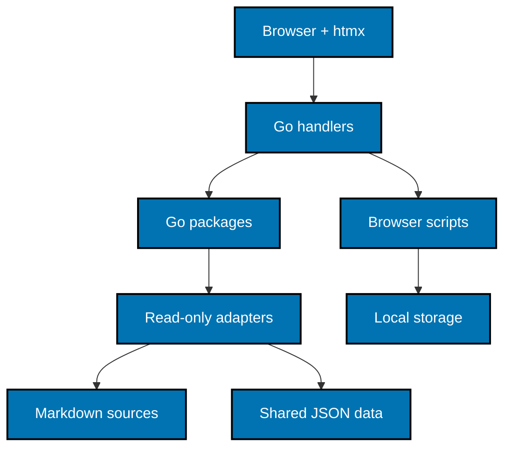
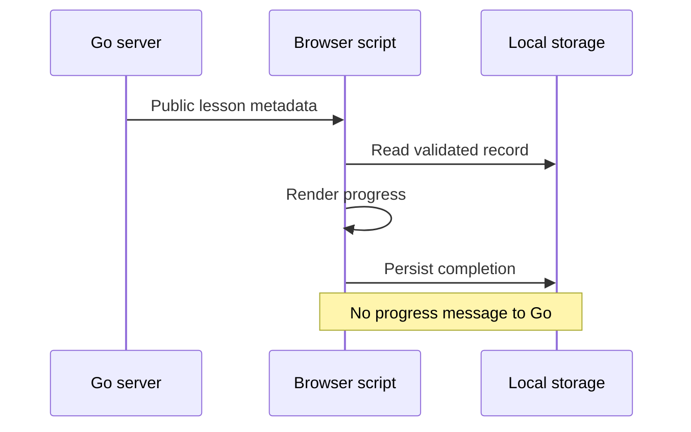

# Architecture and Content

## Runtime shape

Build a single Go module at `apps/ayokoding-web` (module
`github.com/wahidyankf/ose-public/apps/ayokoding-web`, Go 1.26 following the
`ayokoding-cli` precedent). Use only the standard library for the server (`net/http`,
`html/template`) plus htmx for interactive partial updates; the user resolved stdlib over a
web framework, so no Fiber, Chi, Echo, or Gin dependency is introduced. Markdown comes from
goldmark with GFM support, YAML from `gopkg.in/yaml.v3`, sanitization from bluemonday, and
BDD from godog (a normal module dependency, following `apps/ayokoding-cli/go.mod`).

No database, Docker stack, account system, or external runtime service is required. Static
assets (existing CSS, htmx, small vanilla scripts) are served from disk; no Node build
pipeline runs at request time.

## Package and data boundaries

| Boundary                                                | Responsibility                                                                                                                                                                                             |
| ------------------------------------------------------- | ---------------------------------------------------------------------------------------------------------------------------------------------------------------------------------------------------------- |
| `internal/content`                                      | Validated metadata, slug/link resolution, source-independent catalog/tree/sequence decisions, and HTML rendering coordination.                                                                             |
| `internal/coursepaths`                                  | Manifest parsing/validation, phase order, course membership, prerequisites, framing, path-context fallback.                                                                                                |
| `internal/search`                                       | Locale-scoped forward token matching over titles/body plus static tools, title-before-body result merging, de-duplication, excerpts, and limits.                                                           |
| `internal/tools/benchmark`, `internal/tools/calculator` | Pure calculations and URL codecs using validated shared datasets.                                                                                                                                          |
| `internal/web`                                          | Router, redirect middleware, HTML/metadata/discovery responses, page and fragment handlers, template functions. Translate inputs and outputs here; keep calculations and content rules in domain packages. |
| `assets/js/` vanilla scripts                            | Theme, keyboard focus, localStorage progress, code copy, math/diagram hooks. No browser record is sent to a handler.                                                                                       |

File-backed content, manifest, and data adapters expose narrow interfaces with in-memory fakes
for unit tests. They return explicit success/error values rather than leaking full filesystem
paths to a browser. Validate locale, slug/path segments, query fields, and decoded datasets at
their boundary. Never read a path obtained by joining an unvalidated URL onto the source root.
Reject traversal, encoded separators, NUL, and escaping symlinks with the same missing-page
result.

Use one supervised immutable catalog snapshot per source generation, guarded by `sync.RWMutex`
so simultaneous initial readers share the same scan. A polling file watcher invalidates the
affected source generation; tests inject deterministic change notifications. Publish a new
complete snapshot atomically, and never mutate a snapshot a request is reading. Cache parsed
HTML by source-generation and canonical content identity; a source edit must be visible on the
next successful reload. Do not introduce persistent storage or a search service to solve local
caching.

## Local configuration

Default the app listener to `127.0.0.1:3102`. The server resolves an explicit `--port` flag,
then `AYOKODING_WEB_PORT`, then 3102, validating integer range 1–65535 and failing on malformed
input. Ignore bare `PORT`, matching the repository's app-prefixed configuration convention.
Tests start their own server on 3191 using `AYOKODING_WEB_PORT=3191` and do not reuse an
arbitrary process.

Defaults resolved relative to the new app root are:

| Setting                       | Source                                                                                           |
| ----------------------------- | ------------------------------------------------------------------------------------------------ |
| `AYOKODING_WEB_CONTENT_DIR`   | `../ayokoding-www/content`                                                                       |
| `AYOKODING_WEB_MANIFESTS_DIR` | `../ayokoding-www/src/features/course-paths/manifests`                                           |
| `AYOKODING_WEB_SHOW_DRAFTS`   | false; explicit true only for owned test/authoring fixtures                                      |
| Public asset source           | `../ayokoding-www/public`, exposed by a read-only static file handler with safe path containment |
| Tool data source              | `../../libs/ayokoding-data/data`, JSON decoded directly in Go                                    |

Reuse the existing environment variable meanings without loading another environment tier's files.
Supply a documented uncommitted `.env.local` only if needed; the committed `.env.example` contains
placeholders, not real secret values. Never read or modify `.env.prod` or `.env.stag`. Test bootstrap
uses isolated fixture roots and test secrets before the server starts; no developer
corpus is mutated by a test. Application configuration derives paths independently of shell cwd.

## Go rendering pipeline

Read UTF-8 Markdown, split frontmatter, parse it with `gopkg.in/yaml.v3`, and normalize
using the existing reader's metadata semantics. Invalid required frontmatter is skipped with a
sanitized warning; optional catalog metadata remains tolerant as in the existing schema. Drafts
are hidden unless the explicit draft setting is enabled. Preserve `_index.md` section behavior,
weight ordering, prerequisites, outline status, dates, tags, and course metadata.

Render with goldmark and its GFM extension. Preprocess existing callout, tabs/tab, YouTube, and
steps shortcodes into allowed render nodes; do not interpret source as template directives.
Normalize the first body heading to h2 with the existing relative shift/clamp rule before assigning
stable heading IDs and extracting h2–h4 TOC entries. Resolve `.md` relative links differently for
section indexes and leaf pages, preserving anchors and the current locale URL mapping.

Retain authored safe raw HTML, mathematical notation, fenced-language labels, line structure, and
copy payloads through fixture comparisons. Sanitize executable HTML, unsafe URL schemes, and
event-handler attributes with bluemonday before insertion; never execute Markdown text as template
code. KaTeX and Mermaid run through vanilla browser scripts over known code/math nodes; syntax
highlighting uses goldmark's highlighting extension with an explicit bundled language set and the
current accessible light/dark palette. Unknown languages still render escaped readable code with
working copy.

## Courses and search

Port the current manifest schemas and rules from `course-paths/core/schemas.ts` and its helpers;
accept variable-depth `careers/...` and `skills/...` IDs and derive ordering from phases. Current
transitional manifest allowances remain only while present in the merged source. Malformed files
are skipped with warnings, and a missing manifest root yields the current empty-state behavior.
No content migration or authoring tool is added.

Build a native in-memory search index from published non-section content plus static tool entries.
Keep the current forward-prefix token behavior, locale isolation, title-before-body results,
de-duplication, excerpt rules, and 1–50 result limit (default 20). Derive representative matching and
ordering vectors from `ContentService` against synthetic fixtures before porting; browser-visible
semantics and those vectors are the contract, not FlexSearch's implementation or numeric scores.
An empty dialog input clears results; a malformed htmx fragment request returns a stable inline
validation state. No Node process or prebuilt Next search-data file is required at runtime.

## Shared tools data

Create a language-neutral data library with `data/ai-benchmark.json`, `data/cost-of-living.json`,
and `data/fx.json`, plus `provenance.md` and shared `test-vectors/*.json`. Export the evaluated old
TypeScript objects once, preserving list order, numbers, absent optional properties, configuration,
operator priorities, tier anchors, harness catalogs/defaults, methodology examples, and price-blend
constants. Preserve calculator country/city data, salary ladders, policy constants, and independent
FX snapshot date. Copy provenance held only in source comments into structured metadata or notes.

The old data module paths and named exports remain as typed JSON adapters. Benchmark documentation
generation continues using its existing imports and must produce unchanged generated blocks. Go
reads the same JSON directly; each runtime validates its adapter and runs shared expected-result
vectors for scoring, cost, savings, minimum role, numeric formatting, and query encoding. Do not
refresh data values or source dates during this format migration.

## Browser-only progress and state

Keep key `ayokoding-learn-progress-v1` and the strict v1 record fields: `version`, `completed`,
`lastPath`, and `lastCourse`. Mirror current segment validation, limits, deterministic serialization,
idempotent completion, invalid-record recovery, blocked-storage in-memory fallback, cross-tab
storage events, and reset of this key alone. Theme and resize keys remain `theme`,
`ayokoding-sidebar-width`, and `ayokoding-mobilenav-width`.

The server emits public course/lesson metadata. A vanilla script computes completion, resume cards,
and progress-dependent links entirely in the browser and owns a stable DOM island across htmx
swaps (using `hx-swap="none"` regions or `htmx:load` re-initialization where needed). Public
metadata may arrive from the server, but completion/history never leave the browser. No fetch or
htmx request carries the progress record. `htmx.config` history and reconnect behavior preserve
state without re-upload.

The progress script is Unit-tested with the existing Vitest setup and exercised in real browsers.
Go handler tests prove server HTML and request boundaries; they do not pretend to execute
localStorage. Different ports have different origins; compatible schemas do not imply cross-port
data transfer.
