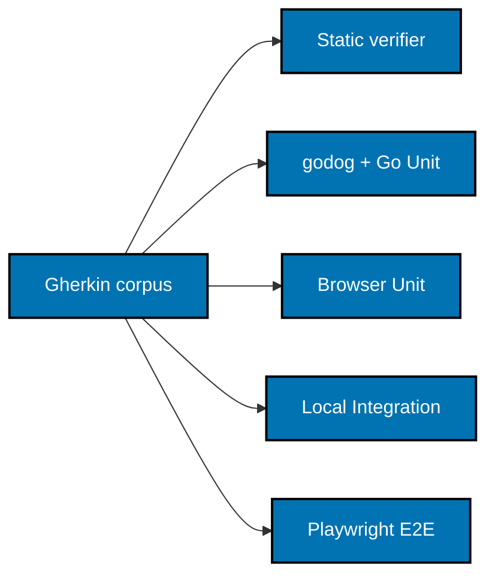

# BDD, Test Layers, and Verification

## Harness contract and precedent

Use godog (Cucumber for Go) as the Gherkin runner, following the proven `ayokoding-cli`
pattern: `apps/ayokoding-cli/go.mod` already requires
`github.com/cucumber/godog v0.16.0`, its `project.json` wires
`test:coverage:unit/integration/e2e/behaviour` through
`scripts/behaviour-coverage.mjs` with Go bindings, and its coverage gate enforces 99% via
`scripts/coverage-gate.sh` with `COVERAGE_MINIMUM=99`. No BDD engine is vendored into `libs/`;
godog is a regular module dependency, and `scripts/behaviour-coverage.mjs` already extracts Go
bindings (`BINDING_FILE` covers `.go`). No JavaScript-side Elixir expression parser or native
verifier adaptation is needed.

The [specs/libs/ex-bdd corpus](../../../../specs/libs/ex-bdd/README.md) stays untouched: it
describes BeaverNest's Elixir engine, which this plan does not import. This plan adds no
`libs/ex-bdd` subtree, no `UPSTREAM.md` import record, and no licensing-notice change for a
vendored engine.

## One corpus, explicit layer ownership

The canonical app corpus is `specs/apps/ayokoding/web/behaviours/**/*.feature`. Each owner has
its own coverage configuration and tests. The Go runtime never depends on a BDD engine; godog
bindings live under the app's `tests/bdd/` tree and run only in test.

| Layer               | Owner and boundary                                                                                                                                                                                         |
| ------------------- | ---------------------------------------------------------------------------------------------------------------------------------------------------------------------------------------------------------- |
| Go Unit             | Plain `go test` over `internal/...` with in-memory fakes; no real filesystem, network, listener, or child process (per the Go skill: `t.TempDir`, real listeners, and subprocesses belong to Integration). |
| Browser-helper Unit | Vitest executes the same assigned Gherkin scenarios for browser-state/focus helpers using in-memory storage/DOM doubles. This is the Unit owner for those scenarios, not a Unit exemption.                 |
| Integration         | `go test ./internal/... ./tests/integration/...` with real local fixture roots, `httptest` servers, fragment-handler assertions, source reload, parsing, and adapter behavior using owned resources.       |
| E2E                 | `apps/ayokoding-web-e2e` uses TypeScript `playwright-bdd` over the owner's canonical corpus and the real local Go server. Browser and request-fixture tests cover public behavior.                         |

A single shared discovery scope selects the exact Go-owned Unit scenarios, applicable Integration
scenarios, and the matching bindings/support; Vitest owns the complementary Unit identities.
Their union must equal all expanded scenarios, with no unowned identity or duplicate ownership.
Integration exemptions require the repository's exact boundary explanation and alternative-proof
comment; never exempt Unit or tag unfinished behavior.

Share app step definitions between Unit and Integration through driver interfaces where the
boundary allows; drivers implement distinct boundaries (in-memory fakes versus fixture-backed
adapters). Do not transplant BeaverNest's domain, storage, account, Caddy, deployment, or
authenticated chat scaffolding — nothing is copied at all.



## Coverage and target contracts

New app targets follow the `ayokoding-cli` Go shape (`project.json` with `nx:run-commands`,
`cwd: apps/ayokoding-web`): `dev`, `build`, `typecheck`, `lint`, `test:unit`,
`test:integration`, `test:coverage:unit`, `test:coverage:integration`, `test:coverage:e2e`,
`test:coverage:behaviour`, and `test:quick`.

- `typecheck` runs `go build ./...` plus a zero-test compile pass (`go vet ./...`).
- `lint` runs the pinned toolchain the same way `ayokoding-cli` does: `go tool golangci-lint
fmt --diff`, `go tool golangci-lint run`, `go tool nilaway`, and `go tool shfmt -d scripts`,
  with `cwd: apps/ayokoding-web`. No new linter configuration style is invented.
- `test:unit` forbids skipped tests (the same `grep -rn Skip` guard `ayokoding-cli` uses)
  and enforces the 99% line-coverage floor through `scripts/coverage-gate.sh` with
  `COVERAGE_MINIMUM=99`; production-code denominators exclude `main`, generated code, and
  test support, documented in the gate script invocation. Tests/support/generated framework
  code do not enlarge or hide production denominators.
- `test:quick` runs typecheck, lint, Unit execution, and aggregate static BDD completeness. It
  never runs Integration or E2E. App runtime E2E belongs to `ayokoding-web-e2e:test:e2e`; the
  app README explains that dedicated owner instead of adding a hollow duplicate target.
- The E2E project's quick target typechecks/lints TypeScript and validates static bindings
  without starting a browser.

Retries are zero in all new product tests. Reject skipped, focused, TODO, or quarantine
behavior through the existing policies. Capture traces on failure, not only on a retry. Use
framework lifecycle and observable completion signals, never sleep or broaden timeouts to
disguise contention or a defect.

## Planned verification commands

These Nx targets become valid in the delivery unit that creates them. Every command runs from
the worktree root. Unit/static work uses `ephemeral/standard`; real corpus/build/browser suites
use `ephemeral/heavy`; dependency installation is `transactional/standard`; servers are
`service/standard`.

```bash
rtk ./hippo run --class ephemeral --resource-tier standard --disk-path . -- npm exec nx -- run ayokoding-data:test:quick
rtk ./hippo run --class ephemeral --resource-tier standard --disk-path . -- npm exec nx -- run ayokoding-web:test:quick
rtk ./hippo run --class ephemeral --resource-tier heavy --disk-path . -- npm exec nx -- run ayokoding-web:test:integration
rtk ./hippo run --class ephemeral --resource-tier heavy --disk-path . -- npm exec nx -- run ayokoding-web-e2e:test:e2e
```

Playwright owns a fresh server on 3191, isolated source fixtures, and browser contexts. Keep
`reuseExistingServer: false`, retries zero, and local Chromium/Firefox/WebKit projects. It
exercises the same Go server binary and static assets that development uses. See
[Playwright server lifecycle](https://playwright.dev/docs/test-webserver), accessed 2026-10-25.

## Manual and terminal proof

Manual browser evidence covers both locales at 375, 768, and 1280 px; capture sanitized screenshots
under the executing plan's `evidence/` with feature, locale, and breakpoint in the filename. Prove
keyboard focus, storage recovery and network privacy, deep links, reconnect, tool query state,
code copying, diagrams/math, htmx partial swaps with and without JavaScript, and no browser
console errors. Compare to the existing app's reference captures. Wire recipes live in the API
companion and delivery checklist.

At the terminal current-main gate, run the live exploratory, usability, and design tester triad,
triage spec-gap/suggestion rows separately, and fix actual defect findings before acceptance.
There is no new REST/GraphQL API: Rule 16's REST/GraphQL API-tester gate is inapplicable, with
the evidence in the API companion; HTTP page/fragment behavior still receives request/browser
proof.
