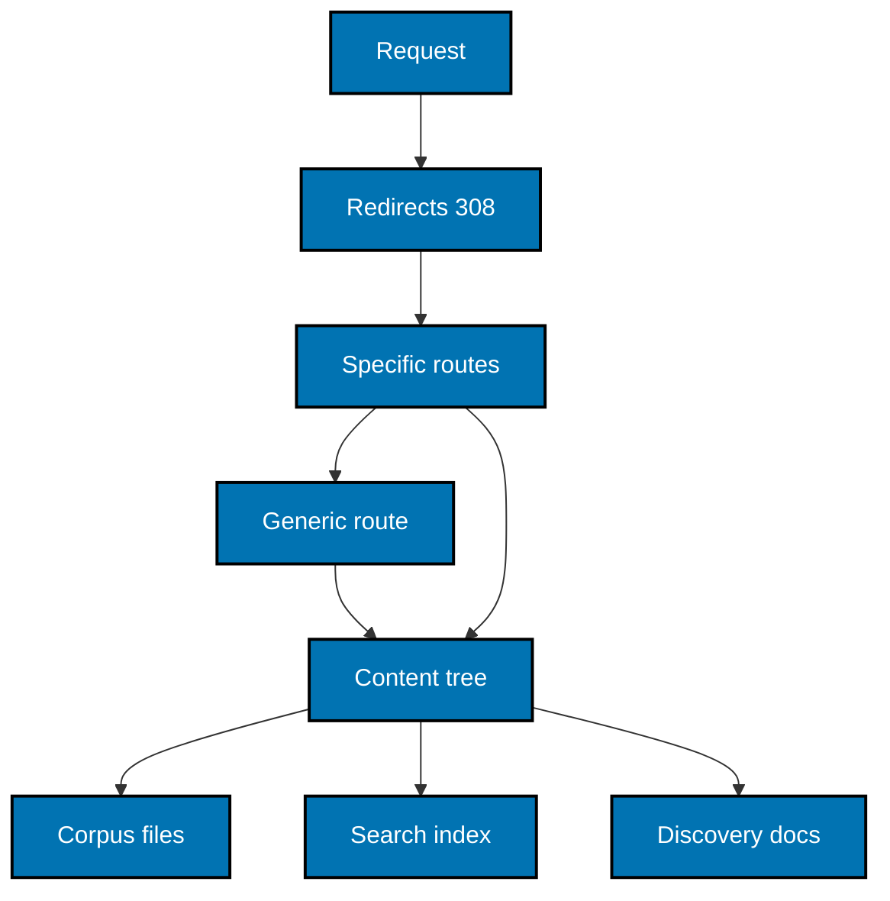

# Parity Program Design

This companion teaches the amendment recorded on 2026-11-28. Read [README](../README.md#amendment-2026-11-28-parity-first)
first for the owner decisions. Everything here is design; the ordered actions are in the
[delivery checklist](../delivery.md). Symbols that already exist are named exactly as they appear in
`apps/ayokoding-web`; a symbol marked _New_ does not exist yet, and its name is chosen in the RED step
that first needs it.

## Why the bar is full parity

Phases 0 to 2 delivered a local app that proves behaviour against a canned fixture corpus. The owner
decided that the Go app must match the old site in full, design included, and that no old URL may
be lost, so the Go app must serve everything the old site serves, look like it, and be provable at the HTTP boundary. Three terms used below:

- **Real corpus** — the files under `apps/ayokoding-www/content/`, the manifests, and the public assets
  that the old app reads. It holds about 3,400 Markdown files (2,089 under `en/learn/courses`, 1,150
  under `en/learn/legacy`, plus paths, rants, the Indonesian trees, and the loose root pages).
- **Fixture corpus** — the small canned corpus that `SeedFixtureDeps` builds in
  `internal/web/seed.go`. Tests use it because it is stable.
- **Parity crawl** — a program that requests every URL of the old site against the new one and fails
  on any 404, redirect loop, or temporary redirect.

## Audit of the current state

The audit was re-run against `origin/main` at `71c7ae840`. Every row cites the file that proves it.

| ID  | Finding                                                                                                                                                                                                                                        | Evidence                                                                                                        | Closed by                   |
| --- | ---------------------------------------------------------------------------------------------------------------------------------------------------------------------------------------------------------------------------------------------- | --------------------------------------------------------------------------------------------------------------- | --------------------------- |
| G1  | The fixture is the default. `ResolveConfig` starts with `Fixture: FixtureParity`; `main.go` always calls `SeedFixtureDeps`; `withFileBackedSources` returns the canned deps when `AYOKODING_WEB_CONTENT_DIR` is unset or unreadable.           | `internal/web/config.go`, `cmd/ayokoding-web/main.go`, `internal/web/seed.go`                                   | `P3-Corpus`                 |
| G2  | The search index is `search.NewFakeIndex` with five entries, and `Deps.Redirects` is a one-entry map. The ordered redirect rules in `redirects.go` are hand-copied from the TypeScript modules with no drift check.                            | `internal/web/seed.go`, `internal/web/redirects.go`                                                             | `P4-Search`, `P4-Redirects` |
| G3  | Only `/{locale}/learn/...`, two tool pages, `/{locale}/search`, and `/{locale}` are routed. `content.LoadFS` reads only `learn/courses` and `learn/legacy`; rants, root pages, and every Indonesian tree are skipped with a diagnostic.        | `internal/web/server.go` route table, `internal/content/load.go`                                                | `P4-Tree`                   |
| G4  | A lesson route has one `{lesson}` segment and `SafeSlug` rejects `/`, so a nested lesson and a section `_index` page cannot be reached even though `LoadFS` stores nested slugs. `SafePath` (multi-segment) exists and is used only by legacy. | `internal/web/server.go` (`handleLesson`), `internal/content/pipeline.go`                                       | `P4-Tree`                   |
| G5  | There is no `/{locale}/browse` and no `/{locale}/tools` index route. `/en` and `/id` render `templates/home.html`, a stub with a heading and a description.                                                                                    | `internal/web/server.go`, `internal/web/templates/home.html`                                                    | `P5-Surfaces`               |
| G6  | `discoveryURLs` and `templates/feed.xml` hard-code `https://ayokoding.example`; the sitemap lists two locale roots plus lessons only; robots says `Sitemap: /sitemap.xml` (relative).                                                          | `internal/web/server.go` (`discoveryURLs`, `robotsContract`), `internal/web/templates/`                         | `P5-Discovery`              |
| G7  | Thirteen call sites set `Cache-Control: no-store`, including pages, assets, and discovery documents.                                                                                                                                           | `grep -n 'Cache-Control' internal/web/*.go`                                                                     | `P5-Cache`                  |
| G8  | Page-by-page visual parity was deferred ("Full P0 design parity remains deferred follow-up (re-check D1)").                                                                                                                                    | [delivery.md](../delivery.md) Phase 8, item D1                                                                  | `P6-*`                      |
| G9  | The old tRPC API (`/api/trpc/*`) is intentionally not reproduced; the new app must answer it with the ordinary 404, and the plan records that as a decision.                                                                                   | `apps/ayokoding-www/src/app/api/trpc/[trpc]/route.ts`; decision D4 in [005](./005-decisions-and-file-impact.md) | `P7-Crawl`                  |

## Target request flow

## Contracts

### Corpus configuration (G1)

Three launcher settings select the corpus. Precedence is flag, then prefixed environment variable, then
default, exactly like the port.

| Setting        | Flag / variable                                      | Default                                                                                                                     |
| -------------- | ---------------------------------------------------- | --------------------------------------------------------------------------------------------------------------------------- |
| Content root   | `AYOKODING_WEB_CONTENT_DIR` (existing)               | First existing of `apps/ayokoding-web/content`, then `apps/ayokoding-www/content`, under the repository root found as below |
| Manifests root | `AYOKODING_WEB_MANIFESTS_DIR` (existing)             | First existing of `apps/ayokoding-web/manifests`, then `apps/ayokoding-www/src/features/course-paths/manifests`             |
| Fixture        | `--fixture` flag, `AYOKODING_WEB_FIXTURE` (existing) | None. A fixture is served only when one of the two is set to `parity` or `unavailable-catalog`                              |

The repository root is the nearest ancestor of the working directory that contains `repo-config.yml`.
Walking up keeps `go run ./cmd/ayokoding-web` and the Nx `dev` target working from any directory, which
the existing configuration rule requires ("derives paths independently of shell cwd"). The two-candidate
list is deliberate: a move of the content into `apps/ayokoding-web/` needs no code change, because the first
candidate then wins. Startup logs which directory it chose.

Failure rules: if no candidate exists and no variable is set, or the chosen directory cannot be read,
startup exits non-zero with a message that names the setting, and no listener opens. The silent
fall-back to the fixture in `withFileBackedSources` is removed. A reload failure after a successful
start keeps serving the last good snapshot and records a diagnostic; that behaviour already exists
and must not change.

### One content tree (G3, G4)

`content.LoadFS` today builds `Page` records for courses and legacy. The parity program adds one
slug-keyed catalog (_New_, recommended name `content.Tree`) that holds every Markdown file under
`<root>/<locale>/` as a node:

| Field                                         | Meaning                                                                                                 |
| --------------------------------------------- | ------------------------------------------------------------------------------------------------------- |
| Locale, Slug                                  | `en` or `id`, and the slash-joined path below the locale (`learn/courses/x/learning/y`, `rants/2023/z`) |
| IsSection                                     | True when the file is an `_index.md`; the slug is then its directory                                    |
| Title, Date, Description, Weight, Draft, Tags | Frontmatter, with the same tolerance rules as the existing loader                                       |
| Body                                          | Rendered by the existing goldmark and bluemonday pipeline                                               |
| Parent, Children                              | Derived from the directory structure and ordered by weight, then title                                  |

The existing course, lesson, and legacy handlers keep their routes because they add behaviour (path
context, progress, prerequisites). Everything else goes through one generic route registered after
them, `GET /{locale}/{slug...}`, that resolves the slug against the tree and renders a content page
or a section listing. A lesson route changes from `{lesson}` to `{lesson...}` so nested lessons reach
the same resolver, validated with `SafePath` instead of `SafeSlug`. Go's `ServeMux` picks the most
specific pattern; the RED test for the generic route proves that specific routes still win and that an
ambiguous registration fails at start, not at request time.

The generic handler mirrors the dispatch order of
`apps/ayokoding-www/src/app/[locale]/(content)/[...slug]/page.tsx`: Learn home, course catalog, course
landing, paths routes, then generic content or section pages, else the localized 404. The executor
reads that file before writing the RED test and records any rule not listed here.

Draft, invalid-frontmatter, and unsafe-path rules are unchanged: a draft is hidden unless
`AYOKODING_WEB_SHOW_DRAFTS=true`, and an unsafe segment returns the localized 404 without a path.

### URL compatibility contract and the parity crawl (G9, owner decision 2)

A URL is **compatible** when `GET` returns `200`, or a chain of permanent `308` responses of at most
five hops that ends in `200`. Any `404`, `5xx`, `307`, loop, or hop limit overflow is a failure. The
inventory has three parts, generated once from the old app at a recorded revision and committed:

| Part             | Source                                                                                                                                          | Check                                                                                 |
| ---------------- | ----------------------------------------------------------------------------------------------------------------------------------------------- | ------------------------------------------------------------------------------------- |
| Sitemap URLs     | Every `<loc>` of the old `GET /sitemap.xml`, reduced to its path                                                                                | Compatible                                                                            |
| Fixed routes     | `/`, `/en`, `/id`, `/en/browse`, `/id/browse`, `/en/tools`, `/id/tools`, both tool pages per locale, `/feed.xml`, `/sitemap.xml`, `/robots.txt` | Compatible; discovery documents also keep their media types                           |
| Redirect sources | Every exact source in `src/redirects/*.ts`; for each `:path*` rule its bare root plus two real sub-paths found in the corpus                    | Compatible, and the final path equals the `Location` that the old app answered for it |

A second direction runs on every crawl: every `<loc>` of the **new** sitemap must answer `200`
directly. The old sitemap lists the pages the old app served; the new one may list more, never fewer.

Three redirects are temporary (`307`) in the old app: the by-example parents in `learn-reorg.ts` for
software architecture, system design, and information security. The owner's rule forbids a temporary
answer, so the new app answers `308` for them. The change is recorded as decision D14 and as a
scenario; no other rule changes status.

`/api/trpc/*` is outside the contract. It answers the ordinary 404, and a scenario pins that so the
absence is a decision, not an accident.

The crawl algorithm is the same in three adapters, because every scenario needs Unit, Integration, and
E2E coverage: a Go function over an in-memory server and a synthetic inventory (Unit), the same function
over `httptest.NewServer`, the real corpus, and the committed inventory (Integration), and a TypeScript
crawler over the wire against `BASE_URL` (E2E). The Go and TypeScript crawlers consume the same
inventory file and the same rule text, so they cannot disagree about what compatible means.

### Search index from the tree (G2)

`internal/search` keeps its matching rules (forward-prefix tokens, locale isolation, title before body,
de-duplication, excerpts, limit 1 to 50, default 20). `P4-Search` replaces the canned entries with a
builder that reads the tree at snapshot time and adds the two static tool entries. The index is part of
the snapshot, so a reload replaces it atomically. Memory use is measured, not assumed: a RED measurement in
`P4-Search` records the process memory with the real corpus loaded. The recorded figure has no pass or fail threshold; no memory budget is set by this plan.

### Redirect table (G2)

`Deps.Redirects` (the one-entry canned map) moves into the fixture seed only. The ordered rules in
`redirects.go` stay the single production table. While `apps/ayokoding-www` is served, a Go drift test (Unit, `internal/web/redirects_drift_test.go`)
compares the ordered rules in `redirects.go` with the committed export `internal/web/testdata/www-redirects.json`, which the inline recorded Node command in `P3-Inventory` writes once from the six TypeScript modules; it compares every rule's source, destination, and status with the Go table, with an explicit allowlist of the three by-example differences; its `test:unit` inputs include the www redirect sources, so a change to them re-runs it (three statuses differ on purpose, see above).

### Discovery documents and origin (G6)

A new launcher setting, `AYOKODING_WEB_SITE_URL` with a `--site-url` flag (_New_), holds the origin
every absolute URL is built from. Its default is `https://www.ayokoding.com`, the value of `SITE_URL`
in `apps/ayokoding-www/src/lib/site-url.ts`. The value must be an absolute `http` or `https` origin with
no path, query, or fragment; anything else stops startup with a message. Request headers, including
`Host`, never choose the origin (see [004](./004-api-contract-delta.md#common-constraints)).

The sitemap lists the union of: each locale root; `/{locale}/browse`; `/{locale}/tools` and both tool
pages; every published tree node (sections included); the course catalog and every course landing; and
every path landing. A sitemap file may hold at most 50,000 URLs and 50 MB per the
[sitemaps.org protocol](https://www.sitemaps.org/protocol.html) (read 2026-11-28); about 3,400 pages is
far below it, and a RED test asserts the count stays below the limit so a future corpus that crosses it
fails loudly rather than producing an invalid file. The feed mirrors `feed.xml/route.ts`: English
non-section pages, `<![CDATA[...]]>` titles and descriptions, `pubDate` from the frontmatter date,
`atom:link rel="self"`. Robots names `<origin>/sitemap.xml`.

### Production caching (G7)

The old app sends `Cache-Control: public, max-age=0, must-revalidate` for every `/en/*` and `/id/*`
response (`contentCacheRule` in `static-delivery.ts`). The new policy keeps that behaviour for pages and
adds validators so a revalidation costs no body:

| Response                                        | `Cache-Control`                       | Validator                                                                                     |
| ----------------------------------------------- | ------------------------------------- | --------------------------------------------------------------------------------------------- |
| HTML pages, tool pages, sitemap, feed, robots   | `public, max-age=0, must-revalidate`  | Strong `ETag` from the snapshot generation and the route; `304` on a matching `If-None-Match` |
| Fingerprinted assets and vendored libraries     | `public, max-age=31536000, immutable` | The URL carries a content hash, so a change is a new URL                                      |
| `308` redirects                                 | `public, max-age=3600`                | None                                                                                          |
| `/htmx/*` fragments, `404`, `500`, fixture mode | `no-store`                            | None                                                                                          |

The snapshot generation id changes on every reload, so an edit to a Markdown file changes every `ETag`
at the next reload and no stale body can be served as fresh. `Vary` is not needed because the same URL
never returns a fragment and a page. Tests keep `no-store` available through the fixture mode so
authoring reloads stay observable. A caching reverse proxy or CDN in front of the origin may cache responses; this policy does not depend on its behaviour, because pages revalidate on every request.

### Design parity method (G8, owner decision 1)

The target is the old site's rendering, not a redesign; the pure-refactor exemption in
[UI Mockups Scope](../../../../repo-governance/conventions/formatting/diagrams/ui-mockups-principles-and-scope.md#scope)
still applies, so no design-funnel mockups are produced. The proof is a harness that renders both sites
side by side from the same real corpus and compares them.

1. **Page classes.** The page-class matrix inventories every screen the old app renders and records one
   deterministic sample route per class, chosen by rule from the corpus (for example "the first course
   in catalog order" and "its first lesson"), never by a hard-coded slug, so content plans can keep
   landing. Classes: landing, browse, tools index, AI benchmark, calculator, Learn home, course catalog,
   course landing, paths hub, path category, arc landing, path landing, lesson, section index, plain
   content page (about, terms, rants, belajar, celoteh, konten-video), legacy page, search dialog (open,
   with results, empty), search page, and 404, plus the shell parts that appear on all of them: header,
   navigation, theme toggle, locale switch, footer, mobile navigation sheet, sidebar, table of contents,
   breadcrumbs, previous and next links.
2. **Matrix.** Each class is captured for each locale that has it, at 375, 768, and 1280 px, in light
   and dark themes (the persisted `theme` key sets the theme before load), with animations disabled
   and web fonts loaded.
3. **Comparison.** A full-page pixel comparison plus structural checks: computed font family and size,
   colour tokens, spacing of landmarks, heading order, and focus ring on the same elements. The pixel
   tolerance is measured, not guessed: the harness captures the old app twice and records the largest
   difference between two captures of the same page as the noise floor. A class passes when its
   difference is at or below that floor. Anything above it is listed with a cropped region and is
   either fixed or accepted by the owner in `design-parity-exceptions.md` with a reason.
4. **Where it runs.** The old app must be running, so the comparison is a dedicated Nx target that the
   executor runs under HIPPO with owned servers on 3101 and 3191, not part of `test:quick` or CI. Its
   accepted report and the exceptions file are the evidence. The report
   stays as history; the revisit trigger in [005 D18](./005-decisions-and-file-impact.md#decision-record) covers a regression guard.

The pixel comparison is Go with the standard `image/png` package in `apps/ayokoding-web` (`parity pixel-diff`, Unit-tested there), so no npm pixel library is added. The capture and structural checks stay in the fe home as test-support code with no Unit or Integration adapter.

## Alternatives and prior art

The selected options and their rejected alternatives are recorded as D11 to D23 in
[005](./005-decisions-and-file-impact.md#decision-record). Repository prior art used here: the old app's
route dispatch, redirect modules, `SITE_URL`, `contentCacheRule`, and sitemap and feed routes;
`ayokoding-www-fe-e2e`'s reference screenshots under [evidence/P0](../evidence/P0/); the Go app's own
`LoadFS`, snapshot, and ordered redirect code; and the `ose-www-*-e2e` pair, which shows two e2e homes
sharing one port under `--parallel=1`. External prior art: the sitemaps.org protocol above, and the
Playwright documentation already cited in [003](./003-bdd-and-verification.md#planned-verification-commands).

## Risks and recovery

| Risk                                                             | Response                                                                                                                              |
| ---------------------------------------------------------------- | ------------------------------------------------------------------------------------------------------------------------------------- |
| Content plans change the corpus while parity work is in flight   | The crawl inventory records its source revision; `P7-Crawl` regenerates it and the Phase 8 gate compares with current `main`.         |
| The real corpus exposes renderer defects the fixture never hit   | Each content unit runs an Integration pass over the whole corpus and records the failing pages as RED evidence before fixing.         |
| Memory or start time grows with 3,400 pages                      | Measure in `P4-Search` and record the figure; this plan sets no threshold.                                                            |
| Design differences cannot be reduced to the noise floor          | Record the region, show the owner, and keep it in `design-parity-exceptions.md`; the owner decides, the plan never loosens the floor. |
| A unit lands behaviour that is only half true on the real corpus | Every unit gate runs its Integration and E2E suites on the real corpus before merge; scaffolding without proof does not merge.        |

To abandon a unit, revert its merged PR; no unit changes the corpus, the old app, or any deployed
system. Reverting `P3-Corpus` restores the fixture default and nothing else.
