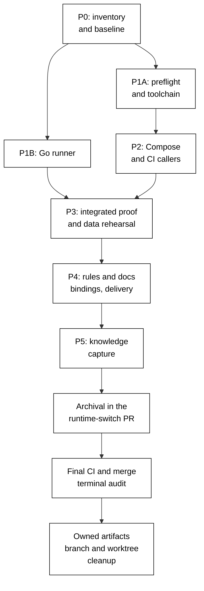

# Delivery: Docker to Podman

**Executor legend:** `[AI]` is executable by the authorized delivery agent; `[HUMAN]` is a named
manual handoff. This plan has no planned human approval gate. A missing machine, credential, or
rootless capability is a blocker to report, not permission to pretend its proof exists.

The maintainer explicitly authorized execution of all phases, delivery to origin/main, and
proof-gated removal of this plan's worktree and development/build artifacts on 2026-10-26.

plan-quality-gate: PASS (3 cycles, 0 open findings).

### Authorized CI evidence timing

On 2026-10-26 the maintainer explicitly selected: collect CI package/rootless evidence on the
runtime PR's first CI run, and require it before merge. P0 records the observed runner tuple and
an explicitly provisional CI pin row; its local Ubuntu/macOS prerequisites still pass before
implementation. The first runtime PR CI validates the exact signed-archive pin/origin and rootless
capabilities before any consumer workload, rejecting drift rather than installing an unreviewed
candidate. CI proof closes at the Phase 4 gate, never after merge. No separate diagnostic PR is
created, and no acceptance criterion or local-platform proof is waived. This resolves the
dependency on CI setup code that does not yet exist under Phase 0's no-PR rule.

On 2026-10-28 the maintainer also authorized CI testing when host memory cannot support the
workload. The bounded exception covers only original row 14 `ayokoding-www:build`, row 20
`ayokoding-www:test:integration`, row 26 `ayokoding-www-be-e2e:test:e2e`, and row 33
`ayokoding-www-fe-e2e:test:e2e`. All four remain pending and must pass in test-only CI on the
first runtime PR before merge. P1 may begin after all other local P0 prerequisites pass and the
coordinator records these exact pending rows and the separately deferred web-UI E2E extra. The
nondeferred targets and two other extras remain local
obligations. Native Ubuntu and Mac capability proof is not replaced by CI. The
existing single runtime PR remains the delivery unit; this adds no deployment step.

The latest checkpoint retains 102 of 106 original identities, 48 of 52 pin-affected identities and
all ten generation groups. Two of three extras passed locally; full web-UI E2E is pending CI.
The P0 boundary passed on 2026-10-28; 13 of 70 actions are complete and P1 is in progress.
See [P0 readiness](./evidence/P0/readiness.md) for the verified boundary and remaining CI debts.

The same standing memory-capacity decision also covers the `web-ui:test:e2e` extra after its local
one-worker run was pressure-shed before any case outcome. Its full 148 cases (118 BDD and 30 visual),
all configured projects, zero retries, original timeouts and snapshots remain mandatory in the same
temporary manual CI route. No local retry is required. P1 entry requires the 102 local original
outcomes, two local extras and the boundary to pass, with the four original CI rows and this extra
explicitly pending. All five require passing, reconciled CI proof before merge.

The current PR quality gate does not run these four runtime commands. Use a temporary, manual-only
test recipe in the existing registered `non-product-full-quality.yml` workflow on this runtime
branch, dispatched with the branch ref and existing evidence nonce. Snapshot the reviewed as-built
workflow including other SWE changes before the overlay; after proof restore those bytes and remove
only the temporary recipe, configuration and task-only harness before merge. Preserve the workflow's
ordinary scheduled purpose and do not land a permanent full E2E PR policy. The current frontend CI configuration selects
only Chromium and two retries; the new proof must preserve all three browsers, zero retries, all
1,236 configured cases including the four original guards, and original timeouts and assertions,
without spoofing CI state. SWE owners will settle the precise configuration. Do not trigger the
scheduled WWW deployment workflow for pre-merge proof: it includes a production force-push.
The manual dispatch uses `gh workflow run non-product-full-quality.yml --ref <runtime-branch> -f
evidence_nonce=<unique-receipt-name>`. Verify the run's resolved SHA, checked-out SHA and reviewed
recipe before credit; a successful dispatch request is not a successful run.

### Authorized Playwright prerequisite repair

On 2026-10-26 the maintainer explicitly authorized Playwright **1.61.0**, including its matching
native browser revisions, to repair the frozen baseline's unsupported Ubuntu 26.04 browser
installation. Before implementation, update the nine exact-pinned E2E manifests and npm lockfile
listed in the technical footprint, verify upstream release integrity and the dependency policy,
then install and exercise the supported browsers. Preserve scenarios, assertions, coverage floors,
timeouts, and resource limits. Revalidate affected baseline targets against the new pin; earlier
1.60.0 passes alone do not prove 1.61.0. This authorization does not approve a Next.js upgrade,
host confinement change, or completion of the remaining local-platform prerequisites.

### Authorized Next.js prerequisite repair

The maintainer separately approved Next.js **16.4.3** for all five current Next.js apps on
2026-10-26, including matching companion pins and the generated lockfile. The exact footprint
appears in the technical document. Serialize it after the Playwright dependency transaction,
verify release integrity and security, then re-run the original OrganicLever font build and
affected gates. Preserve the existing fonts, features, hosting settings, build commands, and
test requirements. Both exact version selections supersede the policy preference for a newer
eligible version; other dependency checks still apply. Neither approval permits a host policy
change or waives missing macOS proof.

### Authorized Ubuntu teardown correction

After the coordinator explained the exact AppArmor denial and host-wide effect, the maintainer
explicitly authorized the receive-SIGTERM correction on 2026-10-26. This permits only a local
include inside the existing pasta profile and the local rule `signal (receive) set=(term)
peer=podman,`. Pasta remains enforced, and normal Unix signal permissions still apply. The
exception changes the earlier no-host-policy-change constraint only for this exact receive rule.
Require independent review of the candidate, guarded backup/apply/rollback, native parse/reload,
unchanged rootless isolation/resource/DNS/keep-id checks, exact native teardown statuses, and
zero positively owned resources/helpers. No unconfined fallback, global policy disable, sysctl
change, rootful workload, or foreign-resource cleanup is authorized.

### Authorized macOS CLI setup

On 2026-10-27 the maintainer reported manually installing Podman on both Macs and requested
CLI-only verification. Native CLI and receipt checks confirm 6.1.4 on both. This replaces the
agent-assisted administrator installer handoff; it does not claim the unobserved installation
transaction ran through HIPPO or link installed bytes to the separately verified package artifact.
The maintainer explicitly authorized native Podman to handle its generated internal VM keys
without displaying or recording their contents. Personal SSH keys remain outside that exception.
Proceed on Desktop first, preserving its existing running Machine. The maintainer initially held
Laptop while configuring it, then explicitly authorized its CLI execution too; inspect its fresh
state before any setup. Actual rootless, resource, DNS and mount proof remains required on the
selected Mac. All agent compute retains the executing host's HIPPO boundary.

### Authorized BDD companion repair

On 2026-10-27 the maintainer explicitly approved `playwright-bdd` **9.2.1** in its ten existing
consumers and the lockfile, with only proven minimal compatibility repairs. Playwright remains
1.61.0; scenarios, assertions, coverage floors, timeouts and report contracts remain intact.
The old adapter fails before generation because Playwright 1.61 removed an internal export.
The upstream fix first appears in 9.1.0; no later stable 8.x fix exists. Verify all ten corpora,
including the directly discovered shared UI consumer. Determine retained app proofs from the
actual resolved dependency comparison, rather than assuming every lockfile change invalidates
every target or that all old passes remain valid.

The coordinator initially used an incorrect seven-day eligibility cutoff when recommending the
version. The repository's actual non-LTS threshold is 60 days; 9.2.1 was 51 days old, while
9.2.0 meets that threshold. The coordinator disclosed this correction and proceeds under the
maintainer's exact 9.2.1 instruction, recording its departure from the default age rule. This is
not normal Path B compliance or a CVE-based Path C waiver. Security and functional checks remain
required; no general dependency policy changes.

### Authorized HIPPO profile compatibility repair

On 2026-10-27 the maintainer explicitly approved HIPPO **0.13.0** and a release-specific
exception to the 60-day age requirement. An external host-profile rollout introduced
`swapUsedMaxMultiple`, which the previous 0.11.0 consumer rejects before payload execution.
The authorized change replaces only the six release-identity and digest values in `hippo.lock`;
the bootstrap and host profiles remain unchanged. Independent source, release-integrity and
security review preceded authorization. Native identity verification, current-profile acceptance,
consumer contracts and one admitted policy smoke passed after the cutover. See the
[HIPPO prerequisite evidence](./evidence/P0/hippo-prerequisite.md).

This is a specific age exception, not normal Path B eligibility or a CVE waiver. Keep old baseline
receipts tied to their original guard/profile and establish retention from actual target inputs
and policy effects. Revalidate affected outcomes precisely; the pin change alone does not require
repeating every passing target. No profile edit, admission bypass or application-test weakening
is authorized.

## Worktree

Worktree path: `worktrees/docker-to-podman/`.

Provisioning status: **provisioned**. The one execution worktree was created from the verified
promotion merge on origin/main. Dependencies and hooks are installed; the required doctor check
now passes after the documented native tool repair. Local P0 prerequisites passed with the named
CI timing exceptions; runtime migration implementation is in progress. Preserve this worktree for the remaining
delivery. Reuse it for all phases and append every later delivery
branch before use. No sibling route or nested worktree is permitted.

### Provisioned Worktree Identity

The execution branch was fast-forwarded to current origin/main
`533a2630cfd8e76cbc8f329efbef60e4d817af50` on 2026-10-27 before launching post-repair baseline
verification. The incoming commits change only Codex model configuration/generated bindings,
HIPPO contributor guidance and the exact already-approved HIPPO lock. All 61 other dirty paths
retained identical status and file hashes. The index is empty; no execution commit was created.
The initial provisioning identity below remains historical provenance.

- Declared repository-relative route: `worktrees/docker-to-podman/`
- Initial branch: `docker-to-podman-base`
- Created by: Codex coordinator `/root`, creation command session `16426`
- Created at: `2026-10-26T12:03:44Z`

### Delivery Branch Inventory

| Branch                  | Mode        | Lifecycle state | Proof                                                                                                                                                                                          |
| ----------------------- | ----------- | --------------- | ---------------------------------------------------------------------------------------------------------------------------------------------------------------------------------------------- |
| `docker-to-podman-base` | provisioned | active          | `git worktree add -b docker-to-podman-base worktrees/docker-to-podman origin/main`, session `16426`, exit 0; initial head `71bb3aa5cadc1043e709e6cb13c2e0ffd8f489a7` at `2026-10-26T12:03:44Z` |

Each eventual PR entry records its merged PR and 40-character reviewed head. Before cleanup,
classify every entry as delivered, unused, or retained/escalated. Never store machine names or
resolved home paths in tracked docs. The separate promotion branch was already delivered and
removed; its proof appears under the completed promotion action.

See [Worktree setup](../../../repo-governance/development/workflow/worktree-setup.md) and the
[worktree specification](../../../repo-governance/conventions/structure/plans/worktree-specification.md).

## Delivery Mode: worktree-to-pr

`main` is the sole integration target. One coherent runtime-switch PR contains phases 1–5,
archival, and their code, tests, rules, docs, specifications, and generated routes. A separate
promotion-only PR lands before Phase 0. Phase 0 itself opens no PR. Archival lands inside the
runtime-switch PR before its final exact-head/base CI and merge; final delivery proof follows merge.

The minimum shippable seam is the complete operational runtime switch: shared toolchain
requirements, runner defaults, CI consumers, and docs must agree. Do not merge individual phases
or half the container callers. No production-disabled feature flag is needed because no partial
new product behavior lands. The existing main remains usable while this work stays unmerged.

### Commit Guidelines

- Do not stage or commit a change set until its delivery is explicitly authorized by the user.
- Once authorized, use the fewest build-valid, independently reviewable and revertible Conventional
  Commits, keeping required specs, tests, docs, generated mirrors, and rollback with their behavior.
- PR bodies state new-code cost/benefit: the small rootless preflight replaces duplicated shell
  checks; one setup action replaces the Docker setup action. No new runtime-selection framework.
- Fresh-context leak review judges each push and merge head. The exact current head/base must pass
  `.github/workflows/pr-quality-gate.yml`. Broad semantic PR review runs only when requested.
- After any new commit lands, read its full diff and reconcile this plan, touch ledger, active
  decisions, and test evidence before continuing. Never change Git identity.

## Parallelization Model

Use **N=3 workers plus one coordinator**, the repository default. Dispatch code/config changes to
the fitting SWE agents. The rules-fixer owns canonical rule propagation; generated bindings are
produced by Rhino, never handwritten.



P1A and P1B write disjoint paths and may run concurrently. P2 waits for the shared preflight and
runtime contract; its two packets (local stack callers and CI) may run concurrently with distinct
owners. Shared `package.json`, `repo-config.yml`, workflow inputs, action names, catalog tags, and
spec/coverage mappings serialize through their named owner. P3 waits for every implementation
packet. P4 may prepare documentation drafts earlier but cannot complete against a changing design.
All paths land in the same runtime-switch unit.

### Delivery Boundaries

| Unit           | Change-producing phases  | Deployable state                                                                                                                                  |
| -------------- | ------------------------ | ------------------------------------------------------------------------------------------------------------------------------------------------- |
| Promotion      | Before Phase 0 only      | Pure plan move and forced index/status/link updates; no runtime change.                                                                           |
| Runtime switch | Phases 1–5 plus archival | Every operational caller, rule, test, doc, and binding uses the proven Podman contract; knowledge capture and archived plan land in this same PR. |

Phase 0 contributes baseline evidence to the runtime unit but opens no implementation PR. The
post-merge terminal audit produces final-delivery proof; it does not create a speculative follow-up
archival PR. Any bounded knowledge-capture edit is reverified before the same delivery PR merges.

Only `ose-public` is mutated. Static checks are ephemeral/light; normal focused tests are
ephemeral/standard; full E2E and image builds use the measured standard/heavy tier; installation
and shared-output regeneration are transactional/standard; running stacks are service/standard.
Every compute process enters HIPPO on its executing host. Independent checks may overlap only
after complete HIPPO admission; dependency, shared-output, byte-identity, and transactional edges
still serialize. CI uses the same host-boundary rule, not a local wrapper around transport.

Cleanup is the terminal node and depends on every delivery node, including the post-delivery
audit. It invokes [Dev Artifact Clean-Up](../../../repo-governance/workflows/maintenance/dev-artifact-clean-up.md)
and its ownership checks. Neither peer worktree is an owned cleanup target.

## Evidence contract

Use `evidence/P0/` through `evidence/P5/` for sanitized durable summaries with revision, command,
working directory, tool versions, HIPPO admission, exit code, executed test identities/counts, and
attributable logs. Raw logs and backups stay in ignored `local-tmp/plan/docker-to-podman/`.
An absent output, missing host, unrun job, or cache hit is not fresh runtime evidence. Capture RED
and GREEN for behavioral changes; static formatting is not a substitute for executable proof.

Use the commands below at the execution worktree root. When a command is a template, first freeze
its concrete project or fixture selection in the phase evidence and execute that recorded value.
Never run production/shared-system examples or publish an image solely to validate documentation.

## Before Phase 0: Pure Promotion

- [x] [AI] Classify the promotion state through the repository's promotion-recovery procedure.
      On its own short-lived branch, move `plans/backlog/docker-to-podman/` to
      `plans/in-progress/docker-to-podman/`, and make only the forced status/link/three-index/DAG
      changes. Deliver that promotion-only PR with current-head/base CI and leak review before
      provisioning the execution worktree or starting Phase 0. Rebase shared plan indexes on current
      main before merge; retain proof of the merged promotion and clean up its temporary branch.

  **Date:** 2026-10-26. **Status:** Complete. **Files Changed:** the six plan files moved to
  `plans/in-progress/docker-to-podman/`; `plans/README.md`, `plans/backlog/README.md`, and
  `plans/in-progress/README.md`. Promotion [PR #745](https://github.com/wahidyankf/ose-public/pull/745)
  merged as `71bb3aa5cadc1043e709e6cb13c2e0ffd8f489a7`; reviewed head
  `8a1d6cbe09284331e6c9e662438c1205aec03be1`. Exact-head/base PR quality run `40318340404`
  and validate-env passed; fresh push/merge-head leak reviews reported zero findings.
  The coordinator read the full delivered diff and verified that origin/main contains only the
  in-progress path. Remote auto-deletion was confirmed by repository settings and its head-ref
  deletion event; the local promotion branch and stale tracking ref were removed. No runtime
  change, peer-worktree mutation, or unrelated dirty-file change was included.

## Phase 0: Environment Setup, Inventory, and Baseline

- **Input:** execution authorization, current main, [scope](./README.md#scope-and-boundaries), and
  AC-01 through AC-10.
- **Outcome:** a cleanly attributed baseline and exact operational caller inventory before edits.

- [x] [AI] Re-read `AGENTS.md`, the repository adapter, this plan, worktree setup, resource rules,
      and active user decisions. Run `rtk git status --short` and `rtk git worktree list --porcelain`;
      reconcile with the touch ledger. If either peer worktree has changed, record new metadata locally
      without changing its files, branches, processes, or pause state. Proof: `evidence/P0/baseline.md`.

  **Date:** 2026-10-26. **Status:** Complete. **Files Changed:**
  `evidence/P0/baseline.md`. The setup-manager recorded current trunk/worktree revisions,
  status, and peer metadata after instruction/decision reconciliation; the coordinator verified
  the resulting evidence against the owned file ledger. Phoenix remains at its historical head
  with zero reported dirty paths. Plan 10 remains at its historical head but now reports 472
  tracked status entries and 864 untracked paths; detailed paths are retained only in ignored
  local evidence. Two unrelated prunable registrations and both peer pause states remain
  untouched. Doctor failure is explicitly open; this action claims no clean test baseline.

- [x] [AI] Verify the promotion-only PR is already merged and `origin/main` contains the plan only
      at its in-progress path. Complete execution Step 0 for `worktrees/docker-to-podman/`, sync with
      that trunk, and record actual worktree identity and Delivery Branch Inventory. No implementation
      begins while promotion or provisioning remains pending.

  **Date:** 2026-10-26. **Status:** Complete. **Files Changed:** this plan's worktree identity
  and Delivery Branch Inventory. After verifying promotion PR #745 and its delivered diff,
  the coordinator created the sole declared worktree on `docker-to-podman-base` from
  `71bb3aa5cadc1043e709e6cb13c2e0ffd8f489a7`. Dependencies/hooks and the final doctor check
  passed before further Git mutation or Nx work. A fresh fetch and ancestor check in session
  `70834` exited 0: HEAD equals origin/main, and the registered worktree matches the declared
  route and branch. The initial branch, creator, UTC creation time, and command are recorded
  immutably above. No implementation has begun; the unrelated primary edit is preserved.

- [x] [AI] Bootstrap dependencies/hooks at that worktree root with
      `rtk ./hippo run --class transactional --resource-tier standard --disk-path . -- npm install`,
      then `rtk npm run doctor`. Only on reported drift, run the documented
      `rtk ./hippo run --class transactional --resource-tier standard --disk-path . -- ./rhino toolchain provision --apply`
      and doctor again. Record missing provision recipes as blockers, never bypass them.

  **Date:** 2026-10-26. **Status:** Complete. **Files Changed:**
  `evidence/P0/bootstrap.md`; ignored worktree dependencies/hooks and diagnostic scratch.
  Dependency installation exited 0 with Husky prepare. Doctor initially failed on three tools;
  the declared provision command reported zero vectors, and the documented maintenance fallback
  resolved the cause. Existing pinned .NET tools needed their native invocation PATH; a new
  checksum-verified Flutter 3.41.5 SDK supplies Dart 3.11.3. The final standalone doctor exited 0
  with 24 toolchain checks and zero findings. No declaration, version, shell profile, or safety
  policy was changed; no baseline test is claimed. See the bootstrap evidence for commands,
  admissions, versions, and cleanup ownership.

- [x] [AI] Freeze the Docker caller inventory using `rtk rg -n -i 'docker|buildx|podman|testcontainers'`
      over `package.json`, `repo-config.yml`, `apps`, `infra`, `.github`, `scripts`, active rules/docs,
      agents, and canonical skills. Exclude content, generated mirrors, caches, and historical trees
      from editing. Expand the [file-impact families](./tech-docs.md#file-impact-analysis) to exact
      paths, classify each retained mention, and record supported versus unsupported stacks in
      `evidence/P0/runtime-inventory.md` before changing any caller.

  **Date:** 2026-10-26. **Status:** Complete. **Files Changed:**
  `evidence/P0/runtime-inventory.md` and the annotated file-impact section in `tech-docs.md`.
  The setup-manager froze 5,212 scan matches across 529 paths plus 13 spec matches, classified
  retained mentions, and enumerated exact operational candidates. The coordinator reviewed the
  inventory and source passages, resolving extra active rule/index and spec-comment paths within
  the already-authorized whole-repository scope before edits. Historical alternatives and compatible
  filenames remain retained. Three public-site stacks and backend E2E are supported runtime
  paths; native Integration has cleanup-only legacy Compose references, and old app scaffolds
  remain unsupported. No caller, learning-content, or peer file was changed.

- [x] [AI] Record content-tree hashes and peer-worktree revision/dirty-path inventories through
      read-only commands. Keep sensitive/absolute-path output local; publish only repository-relative
      summary and hashes. Include any shared content root already landed by execution time. Proof:
      `evidence/P0/exclusions.md` records AC-09's comparison base.

  **Date:** 2026-10-26. **Status:** Complete. **Files Changed:**
  `evidence/P0/exclusions.md`; ignored reproducible hash helpers/manifests and peer metadata.
  HIPPO ephemeral/light sessions `95750` and `14376` exited 0. The only landed learning root
  contains 21,659 entries and 95,271,791 regular-file bytes; its length-framed path/type/mode/content
  tree hash is `ab08b1be7d34f8a670786c15ff622ecd488f28cf410bb0badb8b07e809974a85`.
  No Phoenix shared root has landed. Peer revisions, status counts, and private status digests
  are recorded without reading or modifying peer file contents. The coordinator reviewed the
  comparison method and evidence; raw paths and manifests remain ignored for P3 reproduction.

- [x] [AI] Inspect current-main versions of plan-10-related build/shard paths against the checkpoint
      intent recorded in the technical design. Record whether the local-image and shard-selection
      repairs have landed. Never cherry-pick or copy peer WIP as a shortcut. Proof: the inventory
      explains how AC-05 will cover the discovered local-store constraint.

  **Date:** 2026-10-26. **Status:** Complete. **Files Changed:** the current-main checkpoint
  section of `evidence/P0/runtime-inventory.md`. A read-only source inspection confirmed that
  explicit local-driver selection and shard-specific toolchain prebuild repairs are not on main.
  Existing course sharding and local-image run/pull safeguards did land in PR #720, but the
  environment Dockerfile still uses raw catalog references with synthetic digest suffixes.
  The inventory anchors the exact paths/lines and requires AC-05 to prove derived build,
  lockfile environment build, and execution in one Podman store, retaining shard-limited recipe
  selection. No peer WIP was read, copied, cherry-picked, or changed.

- [x] [AI] Read the bounded `project.json` set and direct workflow callers named in the
      [affected target matrix](./tech-docs.md#affected-project-target-matrix). Run every listed target
      once as an individual command, except the four named rows deferred to first runtime PR CI, using
      `rtk ./hippo run --class ephemeral --resource-tier standard --disk-path . -- npm exec nx -- run <project>:<target>`;
      use heavy only when the admitted resource estimate requires it. Run sequentially where targets
      share outputs. Record each fully expanded command, revision, and exit code; record fresh
      executed/passed counts for test targets, scenario/mapping counts for `test:coverage:behaviour`,
      and diagnostics for build/lint/typecheck. Positive tests must execute at least one case; if a
      declared target is compile-only, record its configured reason and the adjacent test target
      that supplies behavior coverage. If a
      directly named workflow caller points to another project or target, add only that proven caller
      to the matrix and explain the discovery. Do not widen the scan beyond these files or infer work
      from naming similarity. Repair baseline failures at root cause.

  **Date:** 2026-10-28. **Status:** Complete under the authorized CI timing. **Files Changed:**
  `evidence/P0/pin-upgrade-target-results.md`, `evidence/P0/readiness.md`, and the documented
  prerequisite source/test footprint. Reconciled proof covers 102 of 106 original identities,
  48 of 52 pin checks, ten generation groups, and two local extras. Four Ayo originals and the
  web-UI E2E extra remain pending mandatory manual CI before merge. The local web-UI runner
  announced 148 tests before memory pressure stopped it; no case outcome or pass is claimed.
  Completed target receipts and cleanup remain valid despite the enclosing resource-stop status.
  Boundary evidence check `82210` exited 0 against the current source and composite receipts.

- [x] [AI] Inventory readable owned stack metadata: volume IDs, service image versions,
      disposable/durable classification, and current ports. Preserve unrelated workloads. Record a
      service-specific backup/restore packet for every durable service; no production secrets or
      exports enter tracked evidence. Build separate Podman pin rows for each CI `runs-on` label plus
      evaluated runner Ubuntu release/architecture and each supported local Ubuntu release/
      architecture. Different tuple rows may pin different signed-archive versions; record the
      runner image identifier and compare drift only within the same tuple. The CI package pin
      and capability row is explicitly provisional until the first runtime PR CI, under the
      maintainer's timing decision above; local rows must be verified in P0. On macOS record
      `uname -m`, the official 6.1.4 architecture-specific `.pkg` asset URL and published digest,
      byte size, and accepted package-signature result. If official integrity material is absent or
      rejected, stop. Proof: `evidence/P0/install-inventory.md`.

  **Date:** 2026-10-26. **Status:** Complete under the maintainer-authorized CI timing.
  **Files Changed:** `evidence/P0/install-inventory.md`. The setup-manager recorded filtered
  Docker metadata: zero containers/projects, seven unrelated test volumes to preserve, and no
  relevant port collision; no plan-owned durable service needs a real-data backup packet.
  Local Ubuntu package/version/signed-origin resolution and Python/pipx availability were
  captured. All bounded runtime CI callers use `ubuntu-latest`; the actual evaluated Ubuntu
  image/architecture is recorded and its package/capability row remains explicitly provisional
  until the first runtime PR CI, which must close it before merge. The official macOS 6.1.4
  ARM package matched its published size and SHA-256; native package signature and notarization
  checks accepted it. Private ownership labels, paths, mirror details, and raw logs stay ignored.
  No running workload, account, socket, data, or security policy was changed by this inventory.

- [x] [AI] On each recorded local Ubuntu tuple, recheck `apt-cache policy podman` and its recorded origin,
      then install that row's exact pin with the HIPPO transactional package command below. Do not
      require CI and local Ubuntu to use the same version; do not accept a candidate/origin change
      within a tuple. Capture `python3 --version`, `pipx --version`, and the approved Python path.
      The corresponding CI checks and exact installation run in the first runtime PR CI before
      workloads, as authorized above; this action claims only completed local installation proof.

  **Date:** 2026-10-26. **Status:** Complete. **Files Changed:**
  `evidence/P0/ubuntu-install.md` and `evidence/P0/provider-install.md`. The setup-manager
  refreshed APT metadata once and rechecked the signed Ubuntu origin and exact local pin
  `5.7.0+ds2-3build1`. The admitted idempotent install exited 0 with zero package changes;
  the selected engine reports Podman 5.7.0 and rootless operation. The approved interpreter is
  `/usr/bin/python3` 3.14.4; installed pipx is 1.8.0. The coordinator reconciled the retained
  installation log, native version captures, and transcript terminal receipts. This closes only
  the recorded local Ubuntu tuple; CI remains provisional under the explicit timing decision,
  and macOS plus full capability proof remain separate pending actions.

- [x] [AI] Install Podman Compose and the macOS package in the one copyable HIPPO transactional
      packet below. Set the reviewed package/version/digest inputs and macOS machine-presence value
      from the P0 inventory for the executing platform; on
      Ubuntu, the package version/origin must match that tuple's row; on macOS, the package version
      remains 6.1.4. The pipx environment, resolver inventory, wheel hashes, checksum verification,
      and installer actions stay inside the admitted command. Do not alter `HOME`, disable host
      security controls, change global kernel policy, or use system Python overrides.

  ```bash
  PODMAN_PINNED_VERSION='<tuple package version>' \
  PODMAN_INSTALLER_URL='<verified official 6.1.4 asset URL; macOS only>' \
  PODMAN_INSTALLER_SHA256='<published digest; macOS only>' \
  PODMAN_MACHINE_PRESENT='<true or false from the P0 macOS inventory>' \
  rtk ./hippo run --class transactional --resource-tier standard --disk-path . -- bash -euo pipefail -c '
    case "$(uname -s)" in
      Linux)
        test -n "$PODMAN_PINNED_VERSION"
        sudo apt-get install --yes "podman=$PODMAN_PINNED_VERSION"
        ;;
      Darwin)
        test -n "$PODMAN_INSTALLER_URL"
        test -n "$PODMAN_INSTALLER_SHA256"
        verify_dir="$(mktemp -d "${TMPDIR:-/tmp}/podman-6.1.4.XXXXXX")"
        curl --fail --location --show-error "$PODMAN_INSTALLER_URL" --output "$verify_dir/podman.pkg"
        printf "%s  %s\\n" "$PODMAN_INSTALLER_SHA256" "$verify_dir/podman.pkg" | shasum -a 256 -c -
        pkgutil --check-signature "$verify_dir/podman.pkg"
        spctl --assess --type install --verbose "$verify_dir/podman.pkg"
        sudo installer -pkg "$verify_dir/podman.pkg" -target /
        case "$PODMAN_MACHINE_PRESENT" in
          false) podman machine init --rootful=false ;;
          true) ;;
          *) echo "Machine-presence input must match the P0 inventory" >&2; exit 2 ;;
        esac
        ;;
      *) echo "Unsupported installation host" >&2; exit 2 ;;
    esac
    pipx install --python "$(command -v python3)" podman-compose==1.6.0
    pip_meta_dir="$(mktemp -d "${TMPDIR:-/tmp}/podman-compose-meta.XXXXXX")"
    pipx runpip podman-compose freeze > "$pip_meta_dir/requirements.txt"
    pip_wheel_dir="$(mktemp -d "${TMPDIR:-/tmp}/podman-compose-wheels.XXXXXX")"
    python3 -m pip download --dest "$pip_wheel_dir" --requirement "$pip_meta_dir/requirements.txt"
    if command -v sha256sum >/dev/null 2>&1; then (cd "$pip_wheel_dir" && sha256sum *) > "$pip_meta_dir/wheel-sha256.txt"; else (cd "$pip_wheel_dir" && shasum -a 256 *) > "$pip_meta_dir/wheel-sha256.txt"; fi
    cat "$pip_meta_dir/requirements.txt" "$pip_meta_dir/wheel-sha256.txt"
    podman-compose --version
  '
  ```

  **Date:** 2026-10-27. **Status:** Complete through the maintainer-authorized manual Mac
  installation route described above. **Files Changed:** `evidence/P0/provider-install.md`,
  `evidence/P0/macos-provider-install.md`, and `evidence/P0/install-inventory.md`.
  Ubuntu's exact engine pin and provider environment passed their admitted installation checks.
  The selected Desktop Mac's isolated provider is 1.6.0 with native Python 3.14.7; all four freeze
  entries have recorded wheel hashes. Its invocation-only PATH correction allows the provider
  client check to report engine 6.1.4 and provider 1.6.0, exit 0. Both manually installed Mac
  CLIs and native `com.redhat.podman` receipts report 6.1.4. The separately verified official
  installer matches the published size/digest and accepted Apple signature; the unobserved user
  installation transaction is not claimed as agent-admitted or cryptographically linked to those
  bytes. Existing Machine metadata replaces initialization of an absent Machine. Startup and all
  capability assertions remain the next open action; the Laptop guest boot failure does not
  count as passing runtime proof. This closes installation, not the Phase 0 gate.

- [x] [AI] On macOS, start the already initialized Machine as a HIPPO service-class operation:
      `rtk ./hippo run --class service --resource-tier standard --disk-path . -- podman machine start`.
      Set `PODMAN_COMPOSE_PROVIDER="$(command -v podman-compose)"` at each later Compose entry point.
      On every supported local tuple capture `podman version`, `podman info --format json`, and require
      `podman info --format json | jq -e '.host.security.rootless == true'`; macOS also records
      `podman machine list` and `podman system connection list`. Prove cgroup delegation, DNS, and
      mount ownership before coding. If any rootless capability is unsupported, stop without
      weakening host security or changing kernel policy. CI captures the same required capability
      proof in the first runtime PR CI before workloads, with closure required at the Phase 4 gate.

  **Date:** 2026-10-27. **Status:** Complete for the selected local Ubuntu and Desktop Mac
  platforms. **Files Changed:** `evidence/P0/ubuntu-policy-capability-recheck.md` and
  `evidence/P0/macos-capabilities.md`. Ubuntu's post-correction rootless capability and native
  teardown checks passed. The selected Mac's existing Machine was already running, so it was
  preserved without restart. Its full corrected probe `13990` exited 0 through one target-native
  HIPPO transactional/standard admission. Rootless client/server 6.1.4, explicit provider 1.6.0,
  named/Unix store agreement, keep-id host ownership 501:20, direct/database 512 MiB/0.5 CPU/128 PID
  limits, read-only mount/rootfs, network-none, internal DNS, PostgreSQL 17.11 readiness and no
  published ports all passed. Native cleanup succeeded; complete before/after inventories and
  existing VM helper identities match exactly. No Pod was created. The earlier extra task-created
  empty Pod was positively attributed and removed by separate reviewed command `28227`, exit 0;
  the original probe's exit 1 remains historical. The Laptop's separate failed guest boot is not
  claimed as a runtime pass; its stopped Machine and disk remain preserved. No app stop, security
  relaxation, global connection change or mapping fallback was used. Baseline revalidation and
  the Phase 0 gate remain open; CI retains its explicitly authorized timing exceptions.

### Phase 0 Gate

- [x] [AI] Confirm every AC maps to an owned implementation/test packet, all baseline failures have
      root-cause dispositions, installation origins/versions are recorded, and no inventory path
      extends the approved scope. Proof: `evidence/P0/readiness.md`; all remaining local prerequisite
      commands exit 0. Record the authorized CI package/capability row, four exact memory-blocked
      rows and web-UI E2E extra as pending first runtime PR CI, linked to the Phase 2 CI packet and Phase 4 closure gate.
      No other prerequisite may use these exceptions.

  **Date:** 2026-10-28. **Status:** Passed with the named CI timing exceptions. **Files Changed:**
  `evidence/P0/readiness.md` and this checklist. The coordinator reconciled the acceptance trace,
  caller and package inventories, selected native Ubuntu/Mac capability proof, failure dispositions,
  current source closure, completed targets, and owned retirement. Formatting/checks `42624`,
  evidence verification `82210`, direct doctor `98320` (24 toolchains), and the real pre-push
  hook `62346` all exited 0. The hook checked the tracked working tree and truthful existing
  history; it does not certify untracked additions or the future delivery head. Fresh remote,
  cached main and local HEAD matched, and the index stayed empty. Five test outcomes and the
  provisional CI package/capability row remain explicit pre-merge obligations. P1 may begin.

> **Pause Safety**: current-main runtime behavior is intact; only attributed setup and inventory
> exist. Re-verify with `rtk git status --short` and the recorded P0 baseline command packet.

## Phase 1: Rootless Preconditions and Example Runner

### AC-01–AC-03 — Shared shell preflight and tool declarations

- **Input:** P0 package/capability matrix and exact shell/npm/CI entry points.
- **Outcome:** one small shell check rejects unreachable/rootful engines and missing providers
  before any workload mutation.
- [ ] [AI] Write Gherkin first using the feature owners and exact scenario titles in the
      [runner behavior specification delta](./tech-docs.md#runner-behavior-specification-delta).
      Add only the named scenarios. Bind Unit to pure decisions and native build/local-image argv,
      Integration to fake executables and call ordering, and E2E to a rootless Podman host and the
      selected provider. Preserve the recorded E2E exemption for a real rootful engine because it
      would mutate shared runtime state; the fake Unit/Integration proof is required.
- [ ] [AI] **RED:** add `scripts/container-runtime-check.test.mjs` (new) using Node's existing test
      runner and fake executables. Cover rootless success, rootful refusal before workload invocation,
      unavailable/missing engine, missing/wrong provider, and explicit provider selection even when
      Docker Compose is installed. Run
      `rtk ./hippo run --class ephemeral --resource-tier light --disk-path . -- node --test scripts/container-runtime-check.test.mjs`;
      expect assertion failure for absent preflight behavior, not a syntax/import failure. Save RED.
- [ ] [AI] **GREEN:** implement `scripts/container-runtime-check` (new), add its test to the existing
      `test:validators` script, and replace Docker's tool declaration with Podman/provider checks in
      `repo-config.yml`. Use `swe-developer` for config/code. Repeat the RED command and doctor; expect
      all cases and native tool checks to pass without a Docker requirement. Save GREEN.
- [ ] [AI] **REFACTOR:** keep the preflight limited to reachability/rootless/provider checks and
      existing diagnostic conventions. Run `rtk npm run test:validators`, declared shell lint, and
      the focused cases; expect the same outcomes and no new framework/dependencies. Save proof.
- **Proof:** `evidence/P1/preflight.md`, test identities, fake call log showing no rootful mutation,
  and doctor output on both supported platforms.
- _Suggested executor: `swe-developer`._

### AC-04–AC-06 — Runner default, native builds, isolation, and cleanup

- **Input:** existing Gherkin corpus, container-plan tests, runner fixtures, and P0 capability proof.
- **Outcome:** Podman runs the same fixture contracts without Buildx or a separate builder store.
- [ ] [AI] Write Gherkin first under `specs/apps/ayokoding/cli/behaviours/`: extend the existing
      environment-failure/toolchain scenarios for Podman default, rootful refusal, and same-store
      derived/environment builds. Map every new scenario in the existing coverage configuration and
      Unit/Integration/E2E bindings. Revalidate Docker-specific exemption reasons against Podman; do
      not weaken their assertions or stop any shared engine.
- [ ] [AI] **RED:** extend `internal/domain/containerplan/{build,run,services}_test.go` and the
      existing adapters/CLI tests for default `podman`, native build argv, no BuildKit cache flags,
      keep-id mapping, local-only images, and rootful refusal. Run
      `rtk ./hippo run --class ephemeral --resource-tier standard --disk-path . -- npm exec nx -- run ayokoding-cli:test:unit`;
      expect assertion failures against Docker-specific behavior. Save `evidence/P1/runner-red.md`.
- [ ] [AI] **GREEN:** update only the inventoried Go planner, runtime adapter, CLI settings readers,
      and their fixture responses. Preserve runtime override, code/status/output contracts, tags,
      platform selection, effective ownership, resource flags, service DNS, and ownership cleanup.
      Remove Buildx-cache settings/readers; do not invent a replacement env var. Rerun the same target
      and existing Integration target; expect all applicable cases to pass with positive counts.
- [ ] [AI] **REFACTOR:** remove now-dead cache/Buildx branches and duplicated runtime defaults while
      retaining the current module boundaries. Run
      `rtk ./hippo run --class ephemeral --resource-tier standard --disk-path . -- npm exec nx -- run ayokoding-cli:test:quick`
      and `ayokoding-cli:test:coverage:behaviour` through the same boundary. Preserve the 99% floor,
      scenario identities, and applicable coverage layers; record any new scenarios explicitly.
- [ ] [AI] Run real `ayokoding-cli:test:integration` and `ayokoding-cli:test:e2e` under HIPPO using
      rootless Podman. Exercise runner-owned service, lockfile, cancellation, and orphan-cleanup
      fixtures. Verify resource/ownership/network assertions against actual inspect data; prove a
      derived image and environment run without a registry copy. Save AC-04–AC-06 proof.
- **Proof:** `evidence/P1/runner.md` includes failing/passing deltas, exact test counts, tool versions,
  same-store IDs, inspect assertions, and zero remaining positively owned execution resources.
- _Suggested executor: `swe-developer`._

### Phase 1 Gate

- [ ] [AI] Run the new preflight tests, `rtk npm run doctor`, and `ayokoding-cli:test:quick` plus its
      Integration/E2E targets with the P0 commands and tiers. All exit 0; exclude no prior test and
      retain excluded-content hashes. Rootful and unavailable-runtime negative cases fail correctly.

> **Pause Safety**: focused code and tests are coherent in the unmerged delivery worktree; main
> still uses its existing runtime. Re-verify with the Phase 1 quick-gate command above.

## Phase 2: Compose Callers and CI Publication

### AC-03 and AC-07 — Development and container-backed test entry points

- **Input:** P1 shared preflight, exact P0 active-stack and caller inventory.
- **Outcome:** supported entry points start, inspect, copy artifacts, and tear down owned Podman
  resources on the same ports without requiring Docker Compose.
- [ ] [AI] **RED:** add discriminating fake-command regression cases to the preflight test or the
      existing caller's test seam for provider export, preflight-before-start, status preservation,
      and owned teardown on failure/interruption. Validate Compose files with the selected provider;
      capture the current Docker-only invocation or provider-incompatibility failure, not just a
      search assertion. Run the focused Node test command from P1 and save RED.
- [ ] [AI] **GREEN:** migrate `package.json` container entry points and actual backend E2E shell
      callers to the preflight plus explicitly selected `podman compose`. Adapt only reproduced
      Compose incompatibilities and provider labels. Correct Integration comments while leaving
      native Integration tests native. Preserve existing resource/port/env boundaries and unsupported
      scaffold status. Repeat focused cases, Compose config validation, and the concrete backend
      E2E targets captured in P0; save passing proof.
- [ ] [AI] Execute the exact site/backend ownership order in the
      [current stack command packet](./tech-docs.md#current-stack-command-packet): Ayo's prerender
      artifact copy happens before BE E2E and before stopping the owned 3101 Podman stack; stop that
      stack before FE E2E because Playwright owns a fresh native server on 3101. OSE's unqualified
      BE/FE E2E targets remain native fixture-server proof on 3190; do not claim that they hit the
      Podman service on 3100. OrganicLever FE E2E runs while it can reuse the existing Podman server
      on 3200. Run each backend E2E target without pre-starting its dependency Compose stack; the Nx
      target's shell runner owns startup and cleanup. Keep the unsupported legacy app-scaffold
      callers syntax/caller proof only, not supported-stack runtime evidence.
- [ ] [AI] **REFACTOR:** remove duplicate runtime checks and stale Docker operational comments from
      these callers only. Run shell/TypeScript/Compose lint applicable to touched paths and rerun
      their focused cases. No new command wrapper beyond the shared small preflight is introduced.
- **Proof:** `evidence/P2/local-stacks.md`; exact supported stacks, rootless/provider output,
  health checks and ports, and a separate syntax-only disposition for unsupported scaffolds.
- _Suggested executor: `swe-developer`._

### AC-07 — Shared CI setup and existing image publication

- **Input:** P1 runtime contract and P0 package-version/runner inventory.
- **Outcome:** every CI container job uses Podman with the same external image contract.
- **Pre-merge evidence boundary:** prove the two native backend image builds locally with temporary
  tags, inspect/start them using rootless Podman, and exercise the auth command with a fake registry
  CLI that records arguments but receives no credential. Compare repository names, `latest` and
  commit-SHA tag construction, permissions, and existing triggers against the current workflow.
  This proves build/auth/tag construction without publishing and does not satisfy AC-07 publication.
- [ ] [AI] **RED:** extend existing workflow/validator test seams for the new setup action's
      rootless/provider failure behavior and unchanged caller inputs/triggers. Model the old
      Docker-dependent path with fake executables, and assert native build/publish argument behavior
      without touching a registry. Run `rtk npm run test:validators` and the existing actionlint gate;
      retain the behavioral RED output separately from expected syntax validation.
- [ ] [AI] **GREEN:** create `.github/actions/setup-podman/action.yml` (new) with the exact validated
      native provider version and the Ubuntu package pin selected for the executing runner tuple;
      reject any within-tuple OS/architecture/image/origin drift and rootless assertion failure.
      Replace all inventoried setup-action
      callers, change the web workflow's stop input and every caller together, use `podman cp`, and
      remove Buildx env/cache rotation. Replace both image-publication paths with ephemeral-auth
      `podman login --password-stdin`, native build, and push. Keep GHCR names/tags/triggers and
      permissions. Remove the old Docker action only after all callers migrate. Repeat validators.
- [ ] [AI] **REFACTOR:** remove dead setup/cache branches and ensure no job depends on a Docker
      daemon, Buildx action, or Docker login action. Run the existing actionlint, shell, YAML,
      validator, and harness-enforcement checks over these files. Use no new registry-cache service.
- [ ] [AI] Complete the pre-merge evidence boundary above without contacting GHCR. Save local
      build/start/inspect outputs, fake auth-call trace with no token or credential value, and the
      exact existing tag/trigger comparison in `evidence/P2/publishing.md`. Mark publication as
      pending until the existing authorized workflow trigger runs after merge; do not claim AC-07
      complete from local proof or a fake registry call.
      Prepare the temporary manual test-only workflow recipe for the four deferred Ayo targets and web-UI
      E2E extra, preserving
      full scope, assertions, timeouts and zero retries. Record the executed SHA, recipe and actual CI
      environment. Before the overlay snapshot the reviewed as-built workflow; restore it after proof,
      preserving P2 changes. Rediscover the normal workflow's CLI E2E Podman dependency and preserve its
      verified setup on restoration. Do not use the scheduled WWW deployment workflow for this proof.
- **Proof:** `evidence/P2/ci.md` and `publishing.md`; caller inventory, assertion proof, image-start
  results, credential-handling checks, and preserved trigger/tag/permission comparison.
- _Suggested executor: `swe-developer`._

### Phase 2 Gate

- [ ] [AI] Every active runtime caller in P0 has a migrated owner/path and passing focused proof;
      every retained Docker mention has an allowed classification. Both native image builds and
      supported Compose stacks work. No peer work or lesson hash changed. Run validators plus the
      concrete P0 backend/public-site test commands; all applicable local outputs exit 0. The four
      named capacity-blocked Ayo rows and web-ui E2E extra remain pending first runtime PR CI until
      their proof runs.

> **Pause Safety**: all operational callers agree in the unmerged worktree; main is unchanged.
> Re-verify with `rtk npm run test:validators` and the recorded P2 stack command packet.

## Phase 3: Integrated Proof and Data Rehearsal

- **Input:** completed P1/P2 and P0 resource/data inventory.
- **Outcome:** complete runtime proof on supported environments, including data recovery, before
  documentation describes the migration as available.

- [ ] [AI] Exercise AC-01–AC-06 on Ubuntu and macOS with Docker unavailable to the tested processes
      without uninstalling Docker or stopping peer workloads. Use a task-owned shim that records and
      fails Docker invocations, put it only on those processes' PATH, and verify the log is empty.
      Record rootless engine JSON, provider/version, cgroup limits, mount UID/GID, internal DNS,
      health checks, prerender copy, failure paths, and owned teardown. Save `evidence/P3/platforms.md`.
- [ ] [AI] Complete AC-07's pre-merge proof only: both backend images build, inspect, and start
      under rootless Podman with temporary local tags; the fake registry CLI proves auth argument
      handling without credentials; existing repositories, `latest`/commit-SHA tags, triggers, and
      permissions match. Record this separately in `evidence/P2/publishing.md`. Do not attempt
      GHCR publication before merge.
- [ ] [AI] Rerun every P0-frozen project/target row with the exact HIPPO command and stack pairing in
      the [project target](./tech-docs.md#affected-project-target-matrix) and
      [stack command](./tech-docs.md#current-stack-command-packet) matrices. Compare fresh
      executed/passed counts and outputs against P0; if a directly named caller/config changed,
      perform only the bounded rediscovery defined there before updating the selection. For runner
      toolchains, select fixtures covering each used recipe, platform, service, and lockfile form;
      reuse unchanged course units read-only where the canonical scheduled/full gate requires them.
      Record exact selections and positive counts. Never regenerate lesson outputs to pass.
- [ ] [AI] Perform AC-08 with seeded disposable PostgreSQL data using the
      [backup/restore/compare/rollback packet](./tech-docs.md#disposable-postgresql-rehearsal-packet)
      and the discovered service-version export/restore packet. Compare table data and an
      application-level read/write before/after in a distinct Podman volume; preserve the source and
      backup. For any real owned durable data migration,
      stop only that owned stack after its rehearsal passes. If another service needs a recipe,
      record/prove its supported export/restore before switching it. Save only sanitized proof.
- [ ] [AI] Manually open each supported public-site container in a real browser and exercise its
      existing home/navigation/search readiness path in every supported locale. Capture screenshots
      and HTTP health responses with `rtk curl`; run one existing read-only backend API request per
      backend and the existing DB/broker E2E wire assertions. Record URLs, responses, locales, and
      serving revision under `evidence/P3/manual/`. This container-health/browser/wire evidence is
      separate from native fixture-server BDD targets, especially OSE's default 3190 tests. Do not
      invent an endpoint: use that app's specs.
- [ ] [AI] Record API/UI-feature scope dispositions: the runtime migration changes no API contract
      or unrelated product feature. The prerequisite Mermaid keyboard-access repair does change
      UI behavior; complete its applicable UI specification and sequential EWT/UWT/DWT triad
      before delivery. Rule-16 API-feature retests remain not applicable because no API contract
      changed. If implementation changes any further feature, stop to reconcile scope and add its
      applicable gates before continuing. Verify learning-content hashes and peer-worktree
      non-interference for AC-09.
- [ ] [AI] Rehearse failure recovery on the disposable data stack, then compare the retained source
      against the pre-rehearsal checks. Classify every created resource as removable disposable,
      retained proof, or durable/shared state; run no global prune. Save `evidence/P3/recovery.md`.

### Phase 3 Gate

- [ ] [AI] Before merge, trace AC-01–AC-06 and AC-08–AC-09 to real passing outputs and supported-host
      evidence; verify the data round-trip and rollback rehearsal, empty Docker-call log, unchanged
      content hashes, and no unowned teardown. Also verify AC-07's named pre-merge build/auth/tag
      proof. Missing macOS or other required local-platform evidence blocks this gate. The CI
      package/capability proof, four named capacity-blocked baseline rows and web-UI E2E extra may await the first
      runtime PR CI under the maintainer's timing decisions; they must close at Phase 4 before merge.
      AC-07's actual
      publication is intentionally pending here and cannot be marked passed: the mandatory existing
      GHCR trigger, tag/digest verification, and rootless inspect/start proof happen only after merge
      in Plan Archival's terminal delivery audit. Re-run the recorded failing boundary after any fix;
      do not retry to obtain a lucky result.

> **Pause Safety**: supported workflows are proven and source data retained. Stop only resources
> this plan started; resume by re-running the concrete P3 capability and smoke packet.

## Phase 4: Rules, Docs, Bindings, and Runtime-Switch Delivery

### Repository-local rules propagation

- **Input:** verified as-built runtime and the full rule-bearing surface from P0.
- **Outcome:** one canonical runtime requirement, all derivatives/enforcement aligned, delivered
  in the same runtime-switch unit. Only `ose-public` participates.

- [ ] [AI] Start `rules-propagation` through `rules-fixer` with three falsifiable statements:
      operational container tasks use rootless Podman; Compose callers explicitly use podman-compose;
      cleanup removes only positively owned disposable artifacts while retaining shared/persistent
      data. Freeze revision, dirty paths, scope, reasons, strength, and P0 inventory in the local
      placement record. Existing self-created-only safety meaning is preserved, not generalized away.
- [ ] [AI] Scan and classify conflicts in `repo-governance/`, root instructions, `repo-config.yml`,
      enforcement scripts/workflows, software-engineering style guides, agents, canonical skills,
      and generated bindings. Resolve Docker-specific lower-level requirements against the approved
      runtime decision; record same-level unresolved conflicts for the owner. Preserve native-first
      tooling and HIPPO scheduling; create no obligation for another repository.
- [ ] [AI] Place the canonical runtime obligation in the existing
      `repo-governance/development/workflow/reproducible-environments/containerization-for-complex-environments.md`.
      Keep build-specific mechanics in the existing Docker-monorepo-builds modules and owned-resource
      mechanics in the existing cleanup modules. Replace duplicate obligations with links; update
      maintenance setup modules and CI conventions at their narrowest applicable homes. If a declared
      word budget would overflow, relocate weaker material in the same change rather than raising it.
- [ ] [AI] Write canonical Markdown repairs through `rules-fixer`; dispatch any changed declarations
      or enforcement code to `swe-developer`. Reconcile `repo-config.yml` Podman/provider declarations,
      shell/runtime preflight consumers, existing hadolint coverage, and any exact operational
      instructions in `agents/` or `.agents/skills/`. Record every superseded Docker requirement and
      its replacement home in `evidence/P4/rule-manifest.md`.
- [ ] [AI] Give each rule one enforcement disposition with discriminating proof: native tool
      existence is covered by doctor (missing/conforming executable); runtime rootless is covered by
      preflight and Go regression cases (rootful/rootless); provider selection is covered by caller
      tests (conflicting provider installed/explicit selection). Existing ownership safeguards retain
      their documented judgement-based disposition where ownership cannot be mechanically settled.
      Link that reason and its cleanup evidence; do not claim a text search proves runtime behavior.
- [ ] [AI] Regenerate all declared harness routes together with
      `rtk ./hippo run --class transactional --resource-tier standard --disk-path . -- ./rhino harness adapters generate`,
      then validate with `rtk ./hippo run --class ephemeral --resource-tier light --disk-path . -- ./rhino harness adapters validate`.
      Record every generated path in the touch ledger and land it with its source. Never hand-edit it.
- [ ] [AI] Run deterministic Markdown/frontmatter/headings/internal-link/word-budget and enforcement
      gates declared in `repo-config.yml`, judging exit codes. Run `rules-quality-gate` on this frozen
      change through its documented workflow and resolve its ledger under its bounded convergence
      rule. Record rule homes, enforcement proof, relocations, gate verdict, manifest, and final
      `rules-propagation` status; unresolved required rows block this delivery unit.

### Docs propagation and architecture reconciliation

- [ ] [AI] Run `docs-propagation` on the frozen as-built change. Update only stale operational
      setup, root/project READMEs, CI architecture, active specs, script/action indexes, and canonical
      skill guidance from the P0 inventory. Preserve lessons, generic educational examples, dated
      published records, historical plans, and unsupported-scaffold warnings. Execute every safe
      affected example via its declared entry point; record publishing/shared/secret-bearing commands
      as not-run with reason. Save workflow outputs/status in `evidence/P4/docs-manifest.md`.
- [ ] [AI] Reconcile C4/runtime architecture descriptions in the existing app/CLI spec homes and
      system-architecture docs. The app topology and public APIs do not change; update runtime nodes
      and external-tool labels only where they actually exist. Record no-delta dispositions for
      unchanged HTTP/tRPC/schema contracts and for UI-design work. Confirm the runtime prerequisites
      are reflected in Phoenix's eventual resumption instructions without changing its feature scope.
- [ ] [AI] Recheck AC-10: enumerate every live plan README, read each `Depends-on`, compare exact
      live IDs and edges against `plans/README.md`, and verify acyclicity. Retain Phoenix's Podman
      prerequisite and direct Phoenix dependencies for 06–14; preserve 06→07 and the final join
      from every content plan 06–13 into plan 14. No
      historical completed plan appears as a live graph node. Record `evidence/P4/plan-order.md`.

### Local Quality Gates (Before Push)

> **Important:** Fix ALL failures found during quality gates, including preexisting failures
> encountered in this work, at their root cause. Do not bypass admission, reduce coverage, retry,
> loosen assertions, skip/quarantine tests, or widen timeouts to obtain a pass.

- [ ] [AI] Run `rtk npm run test:validators` and `rtk npm run doctor`; run the frozen affected target
      matrix under HIPPO, including build, typecheck, lint, quick, Integration, E2E, dependency audits,
      and `test:coverage:behaviour` where declared. Use existing guarded root affected aliases only
      when they provide the full required selection. Confirm the terminal outputs exit 0; the four
      explicitly deferred Ayo rows and web-ui E2E extra instead require reconciled CI receipts at
      the pre-merge gate.
- [ ] [AI] Run Markdown lint and Prettier check on the exact changed Markdown/config paths using
      installed local binaries under ephemeral/light admission, plus `rtk git diff --check` and the
      repository's declared cross-language/YAML/workflow gates. Run link and generated-binding gates
      against the final tree. Record positive exit codes and bounded fixes.
- [ ] [AI] Reconcile `git status` with the touch ledger and file-impact inventory. Review the full
      diff, verify learning content/peer work is untouched, and ensure no hosting/secret/shared-state
      change slipped in. Re-run only checks invalidated by a later edit. Freeze the delivery revision
      and the AC-to-proof matrix in `evidence/P4/delivery-readiness.md`.

### Post-Push Verification

- [ ] [AI] Once this implementation change set is authorized for delivery, commit the coherent
      runtime switch, open/update its draft PR to `main`, and obtain fresh-context leak review for
      the exact push head before pushing. Root instructions and hardened push guards remain binding.
- [ ] [AI] Poll CI every two minutes with `gh run list`/`gh run view`; never `gh run watch`. Require
      exact-head/base PR Quality gate and applicable container CI. Investigate failures at root cause,
      preserve logs, repair and push through a fresh-head leak review, and re-run affected proof.
      On this first runtime PR CI, close the authorized provisional runner package/rootless row:
      capture the actual tuple, verify its reviewed exact signed-archive pin/origin before install,
      and prove rootless/provider/cgroup/DNS/mount behavior before consumer workloads. Store
      sanitized proof in `evidence/P2/ci.md`; a missing or failed row blocks merge. Also close each
      deferred Ayo row 14, 20, 26 and 33 and the web-UI E2E extra with complete CI results. Preserve
      all three frontend browser projects, zero retries, the original assertions and timeouts, and
      fresh execution with Nx cache disabled. Record actual CI host/worker settings without claiming
      identity with the earlier local execution envelope. Record the actual executed revision and
      recipe. Before merge compare complete input inventories, additions and deletions, resolved
      dependencies and scenario identities against the final delivery revision; rerun only proofs
      invalidated by later changes. Any missing, failed or unreconciled row blocks merge.
- [ ] [AI] Record the green pre-archival PR head and preliminary publication/hosting proof matrix.
      Do not merge yet: Knowledge Capture and archival must land in this same PR first. Local image
      build/start and auth-command proof must already pass; only trigger-driven publication, hosted
      smoke, merge confirmation, and the terminal audit remain as named final-delivery proof.

### Phase 4 Gate

- [ ] [AI] Required pre-merge local/CI/manual outcomes, rules/docs manifests, generated bindings,
      AC-01–AC-06 and AC-08–AC-10 substantive proof, and AC-07's named pre-merge local
      build/auth/tag proof agree with the current PR head. Verify all four named deferred Ayo
      commands and web-UI E2E extra passed in test-only CI with original scopes and that their executed SHA and recipe
      remain valid for final delivery inputs after complete reconciliation. The separate PR Quality
      gate must pass for the literal current head and base, including after archival and workflow
      restoration. Platform proof cannot be deferred as
      final delivery. Keep AC-07 publication explicitly pending for Plan Archival's mandatory
      post-merge terminal proof; name that and only other genuine post-merge evidence in
      `evidence/P4/delivery.md`, then proceed to Knowledge Capture and archival-in-PR.

> **Pause Safety**: the complete switch is green in an unmerged PR; main, data, and unrelated
> workloads remain intact. Resume with the recorded current-head CI and platform smoke packet;
> do not automatically resume Phoenix or plan 10.

## Phase 5: Knowledge Capture

- **Input:** execution observations in `learnings.md` and the green pre-archival PR proof.
- **Outcome:** every observation has one explicit terminal disposition.

- [ ] [AI] Apply the durable-learning litmus test, then secret/sensitivity and repo-relevance gates
      to each entry. Sanitize examples or discard entries that cannot retain meaning safely. Private
      infrastructure details never enter this public plan. Record discarded entries with reasons.
- [ ] [AI] Route each surviving non-code learning to its owning durable home and land a bounded
      inline correction with required propagation. For code-homed future work, report with handoff
      evidence unless a separate idea artifact is literally authorized. Do not create/update
      `plans/ideas/` without that authorization and never write new backlog work during Knowledge
      Capture. When idea authorization exists, search for overlap before creating a two-pager.
- [ ] [AI] Record each terminal state in `learnings.md`: routed inline, explicitly authorized idea
      path, reported without plan authorization with handoff evidence, or discarded with reason. If
      none arose, record `No generalizable learnings — <reason>` rather than inventing an insight.

### Phase 5 Gate

- [ ] [AI] Verify no learning remains untriaged and no future code-homed learning landed inline.
      Re-run gates invalidated by any durable-home edits; record `evidence/P5/knowledge-capture.md`.

> **Pause Safety**: each learning has a terminal state. Resume by checking `learnings.md` for open
> entries and the current-head audit matrix before archival.

## Plan Archival

- [ ] [AI] Perform the preliminary end-to-end completeness audit: map scope and every PRD AC to
      delivered artifacts, automated/manual/CI proof, data migration/rollback, rule/docs propagation,
      conditional recovery, and Knowledge Capture. Reopen the earliest affected packet for missing
      substantive proof; only final archival-delivery proof may remain pending.
- [ ] [AI] Verify every substantive checklist item is ticked with evidence, supported locales were
      exercised, all local/CI gates pass, and all applicable exploratory defect findings are fixed.
      If a required defect cannot be fixed, obtain explicit user deferral; do not self-defer it.
- [ ] [AI] Register the workflow-owned terminal post-delivery audit task, including exact final
      reviewed/merge head, AC matrix, CI/manual proof, backup/rollback dispositions, and Knowledge
      Capture. Do not assign terminal pass before that audit observes the delivered archival head.
- [ ] [AI] After pre-archival gates pass, run `rtk date +%F` and resolve `<completion-date>` from
      that output. Move via
      `rtk git mv plans/in-progress/docker-to-podman/ plans/done/<completion-date>__docker-to-podman/`;
      preserve evidence, update in-progress/done indexes and live DAG/dependencies, and correct links.
      Commit `chore(plans): move docker-to-podman to done` on the same runtime-switch PR branch,
      push with a fresh head-specific leak review, and require replacement exact-head/base CI and
      applicable finite surface gates. Archival removes the satisfied live prerequisite from
      Phoenix's declaration while retaining its historical dependency and resumption requirements.
- [ ] [AI] Once the archival commit is present and hardened merge preconditions pass, merge that
      same PR under its declared AI authority. Record reviewed head, merge commit, actual jobs, and
      current-main observation. The Phase 2 evidence contains only pre-merge build/auth/tag
      construction proof; it does not satisfy AC-07's publication scenario. Observe the existing
      authorized GHCR trigger for the merged revision, verify both `latest` and commit-SHA tags in
      their unchanged repositories, and inspect/start the published images with rootless Podman.
      Record exact workflow run, source revision, tag-to-digest results, and smoke outcomes in
      `evidence/P4/publishing-terminal.md`. This post-merge evidence is mandatory before AC-07 or
      terminal delivery can be marked passed. If no existing trigger publishes, obtain separate
      authority for the existing publication path or leave terminal delivery incomplete. Never
      push a speculative image solely to validate a document.
- [ ] [AI] Verify existing hosted public URLs after any already-existing deployment triggered by
      this delivery, without changing hosting/deployment configuration. Record HTTP responses and
      serving revision where exposed; a deployment that did not run is recorded as not-run. Run
      the registered terminal audit against the delivered head, including final publication proof.
      Record pass only when artifacts, behavior, proof, and final-delivery evidence agree. A failure
      reopens execution; do not conceal it with a post-merge checkbox edit.

  **Phase 0 observation capability:** the Vercel MCP initialization probe reports
  `Auth required`. Use the documented CI/deploy-branch Git and public HTTP fallback for this
  unchanged-hosting observation; claim a serving revision only where exposed. No dashboard-only
  measurement is required. See [deployment observation evidence](./evidence/P0/deployment-observation.md).

- [ ] [AI] Classify every Delivery Branch Inventory entry as delivered, unused, or retained/escalated,
      naming evidence and owner for retained entries. Run the
      [mandatory pre-removal checks](../../../repo-governance/development/workflow/worktree-and-artifact-cleanup/mandatory-pre-removal-checks.md)
      and [Dev Artifact Clean-Up](../../../repo-governance/workflows/maintenance/dev-artifact-clean-up.md)
      for only this plan's resources; preserve data, base images, backups, and peer worktrees.
- [ ] [AI] Remove the now-unused execution worktree non-force from the repository root with
      `rtk git worktree remove worktrees/docker-to-podman`. Complete every created branch's proof-gated
      [branch cleanup](../../../repo-governance/development/workflow/worktree-and-artifact-cleanup/branch-cleanup.md),
      then `rtk git worktree prune`. Never delete an ambiguous, retained, or unrecorded branch.
- [ ] [AI] Report delivery, terminal audit, retained backup/resource ownership, and satisfied Podman
      prerequisite to the maintainer. Phoenix and plan 10 remain stopped until their authorized
      executors reconcile current main, checkpoints, runtime setup, and remaining gates.
