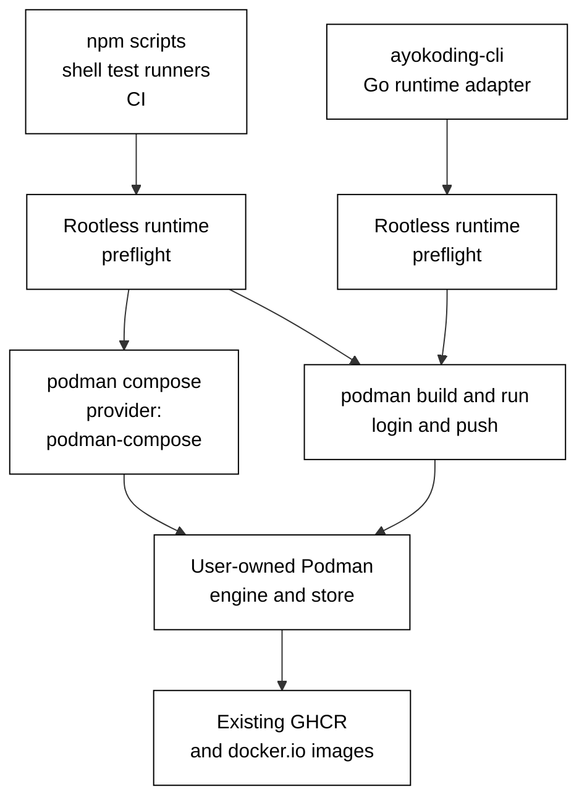
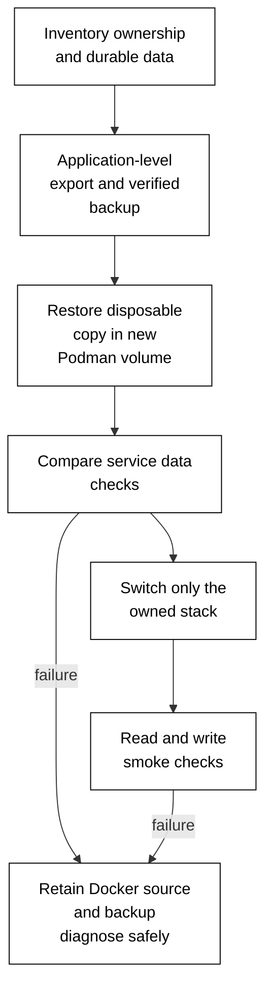

# Technical design: Docker to Podman

## Current state

The authoring checkout was inspected at `98ce02f412f9eb8900052905a8bc84773cb7d0ef` on
2026-10-26. `package.json` starts Compose through Docker; `repo-config.yml` declares Docker a
required tool. The reusable web-test workflow starts containers, copies prerender artifacts, and
tears stacks down through Docker. Backend publishing uses Docker login/build/push. The setup action
configures Buildx and a local BuildKit cache.

`apps/ayokoding-cli/internal/domain/containerplan/build.go` emits `buildx build --load` and local
BuildKit cache arguments. Both that planner and `internal/adapters/containers/run.go` default to
`docker`; the CLI already accepts `AYOKODING_CONTAINER_CLI`. Execution plans include an explicit
UID/GID, bind mount, read-only filesystem, dropped capabilities, no-new-privileges, resource limits,
and per-run labeled networks. Those guarantees must survive the migration.

### Supported stacks and old scaffolds

- `infra/dev/{ayokoding-www,ose-www,organiclever-www}/docker-compose.yml` are the public-site stacks.
- `apps/{ose-be,organiclever-be}/docker-compose.e2e.yml` start dependencies for the actual backend
  E2E scripts. Their Integration scripts now run native filesystem/process tests; misleading
  Docker comments must be corrected without adding containers to Integration.
- `infra/dev/{ose-app,organiclever-app}/` retain unsupported earlier Rust-stack scaffolds. Their
  READMEs explicitly say the paths do not match the current F# applications. Preserve that status;
  change operational terminology and command callers, validate Compose parsing, and do not rebuild
  them into a new architecture. The existing integration Compose files also need an explicit
  active-versus-unused disposition from their callers before claiming runtime proof.

### Existing worktree checkpoints

These are read-only observations, not source approved for copying into this delivery:

| Worktree route                                                 | Inspected head                             | Observed state and implication                                                                                                                                                                                                     |
| -------------------------------------------------------------- | ------------------------------------------ | ---------------------------------------------------------------------------------------------------------------------------------------------------------------------------------------------------------------------------------- |
| `worktrees/ayokoding-app-web/`                                 | `09473ab8fcc8fbfc41a24c72fe596e0e46cb7bee` | User-requested pause recorded in `delivery.md`; 7/86 actions complete, Phase 0 incomplete, Phoenix implementation not started. Preserve its checkpoint and require Podman before resumption.                                       |
| `worktrees/ayokoding-learn-revamp-10-legacy-unique-migration/` | `234e1133a289904a7cfbb3c758044de1f1854636` | 471 tracked files had uncommitted changes. The delivery note records partial waves, toolchain-image blockers, and Buildx local-driver/shard-selection repairs. Preserve all work; its owner resumes only after Podman and Phoenix. |

The plan-10 workflow selects the local Docker driver because a separate builder cannot resolve
locally built toolchain bases. Podman must prove the same-store build/run requirement through
AC-05. When those repairs reach `main`, reconcile their intent before changing the corresponding
paths; do not resurrect the separate builder problem or widen image builds beyond a shard's needs.
Numbers and revisions above are historical observations, not live completion claims.

## Concepts and target architecture

### Execution prerequisite: HIPPO consumer

The maintainer approved the one-file `hippo.lock` update from 0.11.0 to 0.13.0 to accept an
externally updated host admission profile. The root bootstrap is unchanged. The exact pin,
release-specific age exception, security-source limits and passing native consumer checks are
recorded in [P0 HIPPO evidence](./evidence/P0/hippo-prerequisite.md). This prerequisite neither
changes the container runtime design nor authorizes host-profile changes. Baseline retention
must account for the actual original and current policy envelopes.

An image is a packaged filesystem plus configuration. A registry such as GHCR or `docker.io`
stores images. Podman replaces the runtime and builder; it does not require replacing registries
or the Dockerfile language. Rootless means the engine operates in a user's namespace without a
rootful daemon. A Compose provider translates the stack description into runtime operations.



The engine is native on Linux and runs inside Podman Machine on macOS. Runtime preflight checks
the connected engine's reported rootless state, not merely the host UID. It must reject a rootful
remote connection even when the shell itself is non-root.

One supplemental selected-Desktop probe confirmed a rootless bind from Go's observed default
temporary directory, including exact keep-id ownership, read-only behavior, limits and owned
cleanup. Its result does not establish the production runner's temporary-directory selection or
complete runner behavior; the [P0 temporary-directory evidence](./evidence/P0/macos-runner-temp.md)
records the scope. The separate [Desktop capability evidence](./evidence/P0/macos-capabilities.md)
retains the full database and DNS proof.

## Decisions and prior art

The maintainer resolved whole-repo scope, mandatory rootless operation, explicit `podman-compose`,
and the inter-plan order before authoring. The following decisions apply those constraints.

| Decision                         | Selected form and reason                                                                                                                                 | Alternatives considered                                                                                                                                                               | Consequences and revisit trigger                                                                                                                        |
| -------------------------------- | -------------------------------------------------------------------------------------------------------------------------------------------------------- | ------------------------------------------------------------------------------------------------------------------------------------------------------------------------------------- | ------------------------------------------------------------------------------------------------------------------------------------------------------- |
| D1: Runtime                      | Podman for every operational container path, retaining native non-container toolchains.                                                                  | Docker status quo contradicts the requested migration; local-only Podman leaves CI and runner divergence.                                                                             | Every live caller is inventoried. Revisit only if the maintainer changes the whole-repo requirement.                                                    |
| D2: Privileges                   | Require rootless engine operation, including the selected macOS connection.                                                                              | Rootful-only operation contradicts the requirement; automatic rootful fallback masks unsupported permissions or limits.                                                               | Missing namespaces/cgroup capabilities stop the workflow with evidence; no silent limit removal.                                                        |
| D3: Compose                      | `podman compose` with `PODMAN_COMPOSE_PROVIDER=podman-compose` set at repository entry points and CI.                                                    | Implicit provider discovery may select Docker Compose; keeping Docker Compose retains an explicitly rejected dependency.                                                              | Provider version and health-check semantics are tested. Revisit only for a demonstrated unsupported Compose feature.                                    |
| D4: Builds and cache             | Native `podman build --layers --format docker`; job-local cache only, same store for derived images and runs.                                            | Translating BuildKit local-directory cache flags is incompatible with native Podman semantics; registry-backed cache adds publishing/auth/state machinery without a correctness need. | Retire `AYOKODING_BUILDX_CACHE` and cache rotation atomically. Cold jobs may cost more time; measure before proposing persistent caching.               |
| D5: Image and file compatibility | Keep Dockerfile/Compose filenames, ignore files, existing tags/digests, and registry locations. Use Docker image format to retain health-check metadata. | Rename everything to Containerfile/compose.yaml adds churn without removing a runtime dependency; replace image registries expands into hosting/infrastructure work.                  | Hadolint and existing references continue to work. Change a recipe only for a reproduced build incompatibility, then recompute its content-derived tag. |
| D6: Delivery                     | One coherent runtime-switch delivery unit after complete local proof.                                                                                    | Per-application switches leave shared toolchain rules/runner defaults inconsistent; a permanent dual-runtime abstraction doubles the support contract.                                | No temporary flag is needed: existing main remains Docker until the complete Podman change lands. Partial code remains unmerged.                        |
| D7: Data                         | Recreate disposable test data; rehearse application-level export/restore for persistent data into new Podman volumes, retaining Docker sources.          | Sharing raw storage directories crosses incompatible ownership/store boundaries; deleting volumes destroys the rollback source.                                                       | No global prune or automatic Docker uninstall. Revisit the migration recipe if a newly discovered service stores durable state.                         |

### Authoritative sources

Accessed 2026-10-26. These establish documented capabilities, not successful execution in this repo.

- [Podman Compose](https://docs.podman.io/en/latest/markdown/podman-compose.1.html): the command is
  a wrapper around an external provider; its documented provider override prevents Docker Compose
  taking precedence when installed.
- [Podman wait](https://docs.podman.io/en/latest/markdown/podman-wait.1.html): container wait supports
  health conditions, so the disposable database packet can wait for healthy state with a bounded
  subprocess timeout before running SQL.
- [Podman 4.9.3 wait](https://docs.podman.io/en/v4.9.3/markdown/podman-wait.1.html): the Ubuntu 24.04
  package documentation also supports healthy/unhealthy wait conditions used by the same packet.
- [Podman installation](https://podman.io/docs/installation): macOS runs containers through a
  Linux guest managed by `podman machine`; Linux packages use the native distribution tooling.
- [Podman build](https://docs.podman.io/en/latest/markdown/podman-build.1.html): Dockerfiles remain
  supported; Buildx compatibility is incomplete. `--layers` uses the engine's build cache and
  `--format docker` preserves Docker-specific metadata such as health checks.
- [Podman run](https://docs.podman.io/en/latest/markdown/podman-run.1.html): user namespace mapping,
  rootless resource limits, read-only mounts, and internal networks require explicit verification.
- [Podman Compose 1.6.0](https://github.com/containers/podman-compose/releases/tag/v1.6.0): this
  release adds `up --wait` and `--wait-timeout`, required by the existing backend E2E scripts.
- [Podman 6.1.4](https://github.com/podman-container-tools/podman/releases/tag/v6.1.4): the current
  upstream release inspected while authoring. Linux vendor-package versions may differ; record
  the exact supported distribution package and security-update provenance rather than claiming
  all hosts run this release.

## Installation and runtime contract

Use native package management. During P0 create one Podman pin row for each distinct Ubuntu tuple:
CI `runs-on` label plus evaluated runner Ubuntu release and architecture; and local Ubuntu release
plus architecture. The maintainer authorized collecting CI package/rootless proof on the runtime
PR's first CI run, before workloads and before merge; P0 records that CI row as provisional while
fully verifying local rows before implementation. See
[authorized CI evidence timing](./delivery.md#authorized-ci-evidence-timing).
For each tuple, at its authorized verification stage record `lsb_release -ds`, `dpkg --print-architecture`,
`apt-cache policy podman`, and `apt-cache madison podman`. Select that tuple's candidate from its
signed Ubuntu archive, record its exact version and origin, then confirm it is installable with
`apt-get --print-uris --yes install "podman=<recorded-version>"`. Pin and install the version
resolved for that tuple in its setup path; CI and local pins may differ. Compare candidate version
and origin only with the recorded pin for the same release/architecture/runner tuple. A changed
distribution, architecture, runner image, candidate, or origin stops setup for that tuple until
its row is re-resolved and reviewed; version differences between distinct tuples are expected and
are not drift. Never use an unversioned package request. Capture `podman version`,
`podman info --format json`, and `jq -e '.host.security.rootless == true'` output for every tuple.
The runtime check fails if the selected connection is not rootless.

Install `podman-compose==1.6.0` into an isolated `pipx` environment, never into system Python:
`pipx install --python "$(command -v python3)" podman-compose==1.6.0`. Record `pipx list`,
`podman-compose --version`, and `pipx runpip podman-compose freeze` with the Python and pip versions
as P0 evidence. In a private temporary directory, save that freeze output as `requirements.txt`,
download its resolved distributions with
`python3 -m pip download --dest wheels --requirement requirements.txt`, and record each downloaded
wheel's SHA-256 with `sha256sum wheels/* > wheel-sha256.txt` on Ubuntu or
`shasum -a 256 wheels/* > wheel-sha256.txt` on macOS. Put the sanitized version and hash manifests
in P0 evidence. At execution, compare both inventories with that captured setup evidence; a changed
resolver result is a blocker, not permission to accept drift.
Select it explicitly with
`export PODMAN_COMPOSE_PROVIDER="$(command -v podman-compose)"` and verify it resolves to the
`podman-compose` executable at version 1.6.0 before any Compose command. Do not put a resolved
home-directory path from `command -v` in tracked evidence; record executable name and version.

On macOS, use only the official Podman 6.1.4 release page linked above. Run `uname -m`, inspect the
release's published assets, and select the `.pkg` for that architecture together with the
release-published integrity metadata. Record the exact asset URL, architecture, byte size, and
published digest before download. In a new temporary directory, set `PKG_URL` and `EXPECTED_SHA256`
to those recorded release values, then run:

```bash
set -euo pipefail
mkdir -m 700 "${TMPDIR:-/tmp}/podman-6.1.4-verify"
cd "${TMPDIR:-/tmp}/podman-6.1.4-verify"
curl --fail --location --show-error "$PKG_URL" --output podman-6.1.4.pkg
printf '%s  %s\n' "$EXPECTED_SHA256" podman-6.1.4.pkg | shasum -a 256 -c -
pkgutil --check-signature podman-6.1.4.pkg
spctl --assess --type install --verbose podman-6.1.4.pkg
```

Require the digest check to pass and both signature commands to report accepted authenticity
before `sudo installer -pkg podman-6.1.4.pkg -target /`. If the release does not publish
verifiable integrity metadata or the package signature is not accepted, stop; do not install a
substitute. Check `podman machine list` before initialization. If no machine is present, initialize
one with `podman machine init --rootful=false`; if a machine already exists, do not replace or
reinitialize it and require its selected connection to pass the rootless check. Start only the
reviewed machine with `podman machine start`. Record `podman machine list`,
`podman system connection list`,
`podman info --format json`, and the rootless JSON assertion above. Select the connection that
reports rootless operation; reject a rootful connection even if the host account is unprivileged.
Do not disable host security controls or change global kernel policy as a rootless workaround; an
unsupported host is a blocker. No Windows support is added.

Native macOS diagnostics may use the inspected Machine's Unix API socket, but Podman 6.1.4's
Compose wrapper also needs its configured Machine connection. Select the actual named rootless
connection from metadata and verify that connection's `info` result. For Compose, preserve it in
invocation-only `CONTAINER_CONNECTION` as well as the parent's explicit `--connection`: the
podman-compose 1.6.0 provider starts native Podman children without forwarding the parent's
connection argument. Clear conflicting ambient `DOCKER_HOST`, `CONTAINER_HOST` and
`CONTAINER_SSHKEY` for that invocation; retain the explicit provider path. Native Podman may
handle only its generated VM keys under the maintainer's scoped authorization. Do not change the
global connection default. Client version output alone does not prove the selected runtime store;
verify actual uniquely owned resources through both the selected engine and provider.
This behavior is established by the pinned
[Podman Compose implementation](https://github.com/podman-container-tools/podman/blob/v6.1.4/cmd/podman/compose.go#L892-L1092),
[connection environment resolution](https://github.com/podman-container-tools/podman/blob/v6.1.4/cmd/podman/root.go#L2074-L2107)
and [provider subprocess implementation](https://github.com/containers/podman-compose/blob/v1.6.0/podman_compose.py#L1781-L1798).
Actual Mac capability proof remains separate from this source-based transport finding.

The maintainer subsequently authorized one bounded Ubuntu host-policy exception after the exact
denial and host-wide scope were explained: add the missing local include to
`/etc/apparmor.d/usr.bin.pasta` and only `signal (receive) set=(term) peer=podman,` to its existing
local override. Keep pasta enforced and every other security setting intact. Independently review
the exact candidate and partial-apply rollback before application, retain verified backups, and
re-prove native teardown and the unchanged capability checks. This exception does not permit any
other host/kernel/helper policy change or treat provider status alone as cleanup success.

The new shared setup action replaces the existing Docker-cache action, rather than adding a second
container setup path. It selects the package pin recorded for that CI runner tuple and fails when
the current release/architecture/origin does not match its row. Its assertions are
`podman version`, `podman info --format json`, and `podman-compose --version`, with the provider
environment set explicitly. Installing host packages may require package-manager administration;
running workloads never uses sudo/rootful Podman.

### Affected project target matrix

The matrix below is the bounded starting inventory from the current `project.json` files and active
container callers. P0 rereads only these project files plus their directly named Compose/workflow
callers, records a fresh test count for every executed target, and extends the matrix only when one
of those files names another concrete project or container-backed target. Do not infer targets from
similar project names, add unrelated workspace projects, or use a zero-count/no-op target as proof.

| Project                                        | Exact declared verification targets                                                                                 |
| ---------------------------------------------- | ------------------------------------------------------------------------------------------------------------------- |
| `ayokoding-cli`                                | `build`, `lint`, `typecheck`, `test:quick`, `test:unit`, `test:integration`, `test:e2e`, `test:coverage:behaviour`  |
| `ayokoding-www`                                | `build`, `lint`, `typecheck`, `test:quick`, `test:unit`, `test:integration`, `test:coverage:behaviour`              |
| `ayokoding-www-be-e2e`, `ayokoding-www-fe-e2e` | each: `lint`, `typecheck`, `test:quick`, `test:e2e`, `test:coverage:behaviour`                                      |
| `ose-www`                                      | `build`, `lint`, `typecheck`, `test:quick`, `test:unit`, `test:integration`, `build:e2e`, `test:coverage:behaviour` |
| `ose-www-be-e2e`, `ose-www-fe-e2e`             | each: `lint`, `typecheck`, `test:quick`, `test:e2e`, `test:coverage:behaviour`                                      |
| `organiclever-www`                             | `build`, `lint`, `typecheck`, `test:quick`, `test:unit`, `test:coverage:behaviour`                                  |
| `organiclever-www-fe-e2e`                      | `lint`, `typecheck`, `test:quick`, `test:e2e`, `test:coverage:behaviour`                                            |
| `ose-be`                                       | `build`, `lint`, `typecheck`, `test:quick`, `test:unit`, `test:integration`, `test:coverage:behaviour`              |
| `ose-be-e2e`                                   | `lint`, `typecheck`, `test:quick`, `test:e2e`, `test:coverage:behaviour`                                            |
| `organiclever-be`                              | `build`, `lint`, `typecheck`, `test:quick`, `test:unit`, `test:integration`, `test:coverage:behaviour`              |
| `organiclever-be-e2e`                          | `lint`, `typecheck`, `test:quick`, `test:e2e`, `test:coverage:behaviour`                                            |

Run each row's targets individually through HIPPO from the repository root, using ephemeral/standard
for test/build/typecheck/lint and ephemeral/heavy only when measured resource admission requires it.
The exact invocation for each cell is
`rtk ./hippo run --class ephemeral --resource-tier standard --disk-path . -- npm exec nx -- run <project>:<target>`;
the P0 evidence records the fully substituted command, exit code, test-runner-reported executed and
passed counts for test targets, and the baseline revision. For `test:quick`, `test:unit`,
`test:integration`, and `test:e2e`, require at least one executed test unless that project's config
explicitly marks it compile-only; record the reason and adjacent behavior test target. For
`test:coverage:behaviour`, record its checked feature/scenario count and mapping result instead of
claiming test execution. Build, lint, and typecheck evidence records diagnostics and exit status.
At P3, rerun the same frozen target set and compare test counts against P0; a changed project
configuration or newly named workflow caller triggers bounded rediscovery of these directly
affected files before changing the matrix.

### Current stack command packet

Set the explicit provider in each shell or CI job with
`export PODMAN_COMPOSE_PROVIDER="$(command -v podman-compose)"`. A successful `up --wait` plus its
health result proves that a container started; it does not make every Playwright target use that
container. Follow the exact ownership/order below and record native fixture BDD results separately
from container health, browser, and API wire proof. Do not append `-v` to any Compose stop command.

| Caller and Compose file                                                   | Parse and stack health                                                                                                                                                                                                                 | Actual test server owner and command                                                                                                                                                                                                                                                                                                                                                                                                                                                                                    | Stop/ordering rule                                                                                                                                                                                                                                                                                                                                                 |
| ------------------------------------------------------------------------- | -------------------------------------------------------------------------------------------------------------------------------------------------------------------------------------------------------------------------------------- | ----------------------------------------------------------------------------------------------------------------------------------------------------------------------------------------------------------------------------------------------------------------------------------------------------------------------------------------------------------------------------------------------------------------------------------------------------------------------------------------------------------------------- | ------------------------------------------------------------------------------------------------------------------------------------------------------------------------------------------------------------------------------------------------------------------------------------------------------------------------------------------------------------------ |
| Ayo public stack `infra/dev/ayokoding-www/docker-compose.yml`             | `podman compose -f infra/dev/ayokoding-www/docker-compose.yml config`; then `podman compose -f infra/dev/ayokoding-www/docker-compose.yml up --build --detach --wait --wait-timeout 150` and record service health on port 3101.       | After health, perform the existing manifest handoff with `container_id="$(podman compose -f infra/dev/ayokoding-www/docker-compose.yml ps -q ayokoding-www)"`, require it nonempty, then `podman cp "$container_id:/app/apps/ayokoding-www/.next/prerender-manifest.json" apps/ayokoding-www-fe-e2e/.e2e-artifacts/prerender-manifest.json`. Next run `npm exec nx -- run ayokoding-www-be-e2e:test:e2e` while Podman serves 3101; its Playwright `webServer.reuseExistingServer` is true and default base URL is 3101. | After the artifact copy and BE E2E, stop the owned stack with `podman compose -f infra/dev/ayokoding-www/docker-compose.yml down` before `npm exec nx -- run ayokoding-www-fe-e2e:test:e2e`. FE has `reuseExistingServer: false` and owns its native built server on 3101. Final cleanup may stop only the same task-owned Compose project; do not remove volumes. |
| OSE public stack `infra/dev/ose-www/docker-compose.yml`                   | `podman compose -f infra/dev/ose-www/docker-compose.yml config`; then `podman compose -f infra/dev/ose-www/docker-compose.yml up --build --detach --wait --wait-timeout 120` and record service health on port 3100.                   | `npm exec nx -- run ose-www-be-e2e:test:e2e` and `npm exec nx -- run ose-www-fe-e2e:test:e2e` without `WEB_BASE_URL`/`BASE_URL` use the existing native fixture server on port 3190. These commands are native BDD proof only; they do not prove requests reached the Podman service on 3100. The config supports `WEB_BASE_URL`/`BASE_URL` to disable that server, but preserve the current fixture contract and do not silently redirect existing scenarios.                                                          | Keep Podman stack health plus the existing P3 manual-browser and read-only API wire checks as separate required container proof. Stop the task-owned stack with `podman compose -f infra/dev/ose-www/docker-compose.yml down`; never call it native E2E evidence.                                                                                                  |
| OrganicLever public stack `infra/dev/organiclever-www/docker-compose.yml` | `podman compose -f infra/dev/organiclever-www/docker-compose.yml config`; then `podman compose -f infra/dev/organiclever-www/docker-compose.yml up --build --detach --wait --wait-timeout 120` and record service health on port 3200. | Run `npm exec nx -- run organiclever-www-fe-e2e:test:e2e` while the stack serves 3200. Its Playwright `webServer.reuseExistingServer` is true and its default base URL is 3200, so it reuses the existing Podman service.                                                                                                                                                                                                                                                                                               | After the target, stop the owned stack with `podman compose -f infra/dev/organiclever-www/docker-compose.yml down`; do not remove volumes.                                                                                                                                                                                                                         |
| OSE backend E2E `apps/ose-be/docker-compose.e2e.yml`                      | `podman compose -p ose-be-e2e -f apps/ose-be/docker-compose.e2e.yml config`                                                                                                                                                            | Run `npm exec nx -- run ose-be-e2e:test:e2e`. That target invokes `apps/ose-be/scripts/run-e2e.sh`, which owns dependency Compose startup, backend lifecycle, and cleanup. Its migrated start command uses `up --detach --wait --wait-timeout 60`, enough for the existing five health retries at 5s intervals and 5s probe timeout. Do not pre-start a competing Compose stack.                                                                                                                                        | The script's migrated ownership cleanup is the only stop. Preserve the source data; do not issue an extra `down -v`.                                                                                                                                                                                                                                               |
| OrganicLever backend E2E `apps/organiclever-be/docker-compose.e2e.yml`    | `podman compose -p organiclever-be-e2e -f apps/organiclever-be/docker-compose.e2e.yml config`                                                                                                                                          | Run `npm exec nx -- run organiclever-be-e2e:test:e2e`. That target invokes `apps/organiclever-be/scripts/run-e2e.sh`, which owns dependency Compose startup, backend lifecycle, and cleanup. Its migrated start command uses `up --detach --wait --wait-timeout 60`, enough for the existing five health retries at 5s intervals and 5s probe timeout. Do not pre-start a competing Compose stack.                                                                                                                      | The script's migrated ownership cleanup is the only stop. Preserve the source data; do not issue an extra `down -v`.                                                                                                                                                                                                                                               |

The installed provider accepts the table's wait flags but does not reliably propagate native
readiness failures or timeout cancellation; see [the exact provider status findings](./evidence/P0/compose-provider-status.md).
The table's provider command is not sufficient health proof. Existing stack-owning callers must
enforce native running/healthy postconditions before copying artifacts or executing E2E, within
the same total 150/120/60-second budgets. Prefer detached startup followed by that bounded native
check rather than relying on provider waiting. A false successful provider status must fail
before consumers run. P2's existing fake-command seams cover unhealthy/elapsed-deadline cases
and retained owned resources after teardown. Keep the shared P1 preflight narrow and preserve
the exact provider pin, foreign resources and existing healthchecks; add no lifecycle framework.

For Ayo's artifact handoff, create the destination before `podman cp` and reject an empty service
lookup:

```bash
artifact_dir=apps/ayokoding-www-fe-e2e/.e2e-artifacts
mkdir -p "$artifact_dir"
container_id="$(podman compose -f infra/dev/ayokoding-www/docker-compose.yml ps -q ayokoding-www)"
test -n "$container_id"
podman cp "$container_id:/app/apps/ayokoding-www/.next/prerender-manifest.json" \
  "$artifact_dir/prerender-manifest.json"
```

The shared CI workflow additionally has these observed legacy stack tuples. The callers still need
their Docker operations migrated and their Compose files parsed using both explicit files. Their
unsupported scaffold runtime is not evidence that a supported public site works under Podman:

| Workflow caller                                                 | Compose files and E2E targets                                                                                                                                             |
| --------------------------------------------------------------- | ------------------------------------------------------------------------------------------------------------------------------------------------------------------------- |
| `.github/workflows/ose-app-test-local-deploy-stag.yml`          | `infra/dev/ose-app/docker-compose.yml` + `infra/dev/ose-app/docker-compose.ci.yml`; `ose-be-e2e:test:e2e`, `ose-app-web-e2e:test:e2e`                                     |
| `.github/workflows/organiclever-app-test-local-deploy-stag.yml` | `infra/dev/organiclever-app/docker-compose.yml` + `infra/dev/organiclever-app/docker-compose.ci.yml`; `organiclever-be-e2e:test:e2e`, `organiclever-app-web-e2e:test:e2e` |

These two legacy app scaffolds remain explicitly unsupported: preserve that status and migrate the
existing CI callers without turning either scaffold into a supported app architecture. Their exact
syntax-only validation commands are
`podman compose -f infra/dev/ose-app/docker-compose.yml -f infra/dev/ose-app/docker-compose.ci.yml config`
and the matching command with the `infra/dev/organiclever-app/` file pair. Preserve the existing
inferred Compose project name, environment, and workflow inputs. Their workflow outputs remain
caller regressions only, not supported-stack runtime proof. If any tuple differs at execution,
record that observed caller in P0 before adapting the command.

For each supported site capture provider/version, parse status, health status, and ports. Capture
test counts for its paired E2E targets, with native-server tests labelled as native fixture proof
where stated above. At P3, use the required manual browser/API checks to prove container behavior
for OSE. Backend E2E targets record their own test counts and owned-resource cleanup. On failure,
stop dependent work, retain sanitized diagnostics, and clean up only after confirming that
containers/network belong to this execution. Do not repeat a failed startup or remove volumes to
manufacture a pass. Do not invoke `organiclever:dev:reset` as proof; it removes volumes.

Add a small `scripts/container-runtime-check` preflight for shell/npm/CI entry points. It checks the
chosen engine is reachable and its JSON reports rootless operation; a Compose caller additionally
checks the provider executable/version. Use the existing `jq` and shell prerequisites. No service,
daemon, general runtime-selection framework, or new scheduling system is introduced. The script
centralizes a requirement shared by otherwise unrelated shell workflows.

Its interface is `scripts/container-runtime-check [--compose]`: no positional command execution,
no stdout on success, status 0 for a usable rootless engine, 125 for unreachable/rootful engine,
127 for a missing executable/provider, and 2 for invalid arguments or an unsupported provider
version. Diagnostics go to stderr and never contain secret-bearing inspect data. `--compose`
requires the explicitly selected `podman-compose` provider at version 1.6.0. The Go preflight
uses the same decision table. Bind the shared runtime scenarios in
`specs/apps/ayokoding/cli/behaviours/toolchains/rootless-runtime.feature` (new) through the existing
runner corpus and use the shell integration cases as additional protocol proof, not a new spec
owner or a replacement test framework.

The Go runner performs equivalent preflight through its existing injected command-execution seam,
keeping domain planning free of process I/O. Existing fake-runtime tests supply the info response.
Explicit `AYOKODING_CONTAINER_CLI` values still select an executable, including a test fake or a
non-default Podman path; they do not exempt a real workflow from the rootless requirement.

### Runner behavior specification delta

Extend the existing product-owned packets; do not create a new feature owner for these behavior
changes. Keep each durable title exactly as listed so implementation, coverage configuration, and
evidence can refer to the same scenario:

| Feature owner                                                               | Exact scenario title                                            | Scenario contract                                                                                                                                                                   | Required layers                                                                                                                                                                              |
| --------------------------------------------------------------------------- | --------------------------------------------------------------- | ----------------------------------------------------------------------------------------------------------------------------------------------------------------------------------- | -------------------------------------------------------------------------------------------------------------------------------------------------------------------------------------------- |
| `specs/apps/ayokoding/cli/behaviours/examples/environment-failures.feature` | `The runner defaults to Podman when no runtime override is set` | With no `AYOKODING_CONTAINER_CLI`, the planned and executed runtime command is `podman`; existing output and exit-status contracts remain unchanged.                                | Unit: default selection; Integration: fake Podman argv; E2E: default runtime smoke on supported rootless Podman.                                                                             |
| `specs/apps/ayokoding/cli/behaviours/toolchains/rootless-runtime.feature`   | `A rootful connection is rejected before workload creation`     | A fake `podman info` response reporting rootful operation returns 125 and the workload-call log stays empty.                                                                        | Unit: decision and status; Integration: fake executable call order; E2E: no real rootful engine test because it would mutate shared runtime state, with the fake Integration proof retained. |
| `specs/apps/ayokoding/cli/behaviours/toolchains/toolchain-catalog.feature`  | `A derived image is built and run from the same Podman store`   | Build a derived image with the native Podman command, then run it by the same content-derived tag without a registry push/pull; the observed local image identity is the one built. | Unit: build argv and local-reference classification; Integration: fake command order and tag; E2E: supported rootless host proves build-to-run without registry access.                      |
| `specs/apps/ayokoding/cli/behaviours/toolchains/toolchain-catalog.feature`  | `An environment image runs from the same Podman store`          | A local environment image already in the selected Podman store is used directly and is not pulled from a registry; missing-image behavior retains its existing failure contract.    | Unit: local-only pull policy; Integration: fake-store fixture; E2E: real rootless store with registry access disabled after image preparation.                                               |

The remaining shared shell/provider scenarios in
`specs/apps/ayokoding/cli/behaviours/toolchains/rootless-runtime.feature` are titled
`An unreachable engine preserves its environment status` and
`An installed Docker Compose cannot override the selected provider`. Bind them to Unit for the
pure decision, Integration for fake executable/call-order proof, and E2E only for the selected
provider on rootless Podman. Do not add container behavior to product specifications outside the
CLI runner, and do not weaken existing scenario assertions or coverage thresholds.

## Runner and interface changes

- Set both default runtime constants to `podman`; preserve `AYOKODING_CONTAINER_CLI` and existing
  CLI commands, text/JSON schemas, diagnostic codes, and supervisor exit statuses.
- Replace `buildx build --load` with `build --layers --format docker`, maintaining explicit build
  context, Dockerfile path, build args, platform, and content-derived tags. Remove the unused
  BuildKit cache-directory setting and `AYOKODING_BUILDX_CACHE` readers, tests, and workflow writers
  in the same unit; do not add a replacement environment variable.
- Use explicit local-only pull behavior for harness-local derived/environment images. Keep
  catalog tags stable; account for Podman's `localhost/` normalization when classifying local
  image references, without rewriting the external JSON schema or teaching content.
- Preserve the effective host-owner UID/GID inside `/work`. Rootless Linux uses keep-id namespace
  mapping alongside the existing explicit user; the remote macOS mapping is proven against its
  Machine connection. A root-owned/wrong-owner file or inaccessible read-only mount fails proof.
- Preserve no-network execution without services, internal-only service networks, DNS aliases,
  tmpfs service data, CPU/memory/pid limits, dropped capabilities, and no-new-privileges. Verify
  cgroup-v2 delegation instead of dropping unsupported options.
- Inspect Podman network/container JSON and timestamps through fixtures for the actual selected
  versions. Keep per-run cleanup labels and remove only positively owned resources; adapt
  Docker-specific Go templates/diagnostics without weakening cleanup scope.

Application HTTP, tRPC, GraphQL, database schemas, ports, and localization contracts have **no
delta** from the runtime migration. Separately authorized P0 work also changes Mermaid fallback
keyboard access and the Sidebar layout boundary for route-eligible rendering; the applied Sidebar
change avoids the optional runtime request on non-course `?path` routes. These are bounded UI
behavior changes, not part of the container-runtime design. The inline-code binding repair keeps
the original strict style expectations and changes how the current rendered node is observed.
The Sidebar A′ approach supersedes and withdraws the noncompliant derived-state/effect bridge.
Document these source footprints without describing all P0 changes as runtime-only. The applicable
UI specification and sequential EWT/UWT/DWT triad remain required before delivery.

## CI and publishing

Replace all callers of `setup-docker-cache` with the new rootless setup action and remove the old
action only after the caller inventory reaches zero. Rename `stop-docker-before-fe-e2e` to
`stop-containers-before-fe-e2e` with every workflow caller in the same change. Use `podman cp` for
the existing prerender-manifest handoff. Preserve build-vs-E2E ownership and existing test timeouts;
do not add sleeps, retries, or smaller test selections to hide incompatibilities.

Backend publication uses `podman login --password-stdin` with an ephemeral auth file, then
`podman build --layers --format docker` and `podman push`. Keep GHCR repository names, `latest`
and commit-SHA tags, conditional affected selection, permissions, and existing triggers. Remove the
ephemeral auth file in the job's own cleanup. Never print tokens or persist authentication caches.
No new credentials, registry, hosting resource, deployment branch, or cloud account is required.

Compute enters HIPPO on the executing host. Use ephemeral light for static checks, ephemeral
standard/heavy for tests and image builds according to measured needs, transactional standard for
dependency/provisioning mutations, and service standard for running a stack. Do not double-wrap
root npm scripts that already own a boundary. Concurrency follows dependency and shared-output
edges, not available CPU guesses. Every failure retains its original exit code and attributable log.

## Data migration and rollback

Docker and Podman stores remain separate. Record container/volume IDs, stack ownership, service
versions, mount destinations, and whether data is disposable or durable before stopping anything.
Do not include data or secret-bearing inspect output in committed evidence.



For PostgreSQL, use its existing service image version's `pg_dump`/`pg_restore` tools, not a raw
copy of the data directory. For other discovered persistent services, use their supported export
format and prove round-trip semantics on a copy before the owned switch. If no durable volumes are
in active scope, record that inventory and rehearse with seeded disposable PostgreSQL data anyway.
No peer stack is stopped merely to make a port available.

### Disposable PostgreSQL rehearsal packet

This is a prospective execution recipe for AC-08, not an authoring-time command. At P0, confirm
the current PostgreSQL service image tag in `apps/ose-be/docker-compose.e2e.yml`; set `PG_IMAGE`
below to that exact tag if it changed from the observed `postgres:17-alpine`. Do not use a lesson
image or any existing Docker volume; this packet creates a synthetic source in a new Podman volume
and leaves every Docker source untouched. Run the following from the repository root in a shell
with rootless Podman connected. `RUN_ID` must be a new alphanumeric timestamp/suffix for this
rehearsal; its network, two volumes, and two containers are uniquely owned by this run. The
trust-authenticated containers are isolated on their own network, publish no ports, and contain
only the synthetic rows shown.

```bash
rtk ./hippo run --class service --resource-tier standard --disk-path . -- bash -euo pipefail <<'BASH'
umask 077
RUN_ID="$(date -u +%Y%m%d%H%M%S)-$RANDOM"
PG_IMAGE="postgres:17-alpine"
NET="podman-plan-pg-${RUN_ID}"
SRC_VOL="podman-plan-pg-source-${RUN_ID}"
DST_VOL="podman-plan-pg-target-${RUN_ID}"
SRC="podman-plan-pg-source-${RUN_ID}"
DST="podman-plan-pg-target-${RUN_ID}"
WORK_DIR="$(mktemp -d "${TMPDIR:-/tmp}/podman-plan-pg.${RUN_ID}.XXXXXX")"
BACKUP="${WORK_DIR}/backup.dump"

wait_healthy() {
  python3 - "$1" <<'PY'
import subprocess
import sys

container = sys.argv[1]
try:
    subprocess.run(
        ["podman", "wait", "--condition=healthy", container],
        capture_output=True,
        check=True,
        text=True,
        timeout=90,
    )
except subprocess.TimeoutExpired:
    status = subprocess.run(
        ["podman", "inspect", "--format", "{{.State.Health.Status}}", container],
        capture_output=True,
        check=False,
        text=True,
        timeout=10,
    ).stdout.strip()
    print(f"Timed out waiting for {container} health; last status={status or 'unknown'}", file=sys.stderr)
    raise SystemExit(1)

status = subprocess.run(
    ["podman", "inspect", "--format", "{{.State.Health.Status}}", container],
    capture_output=True,
    check=True,
    text=True,
    timeout=10,
).stdout.strip()
if status != "healthy":
    print(f"Expected healthy state for {container}; got {status or 'unknown'}", file=sys.stderr)
    raise SystemExit(1)
print(f"{container}: {status}")
PY
}

podman network create --label owner=docker-to-podman-rehearsal "$NET"
podman volume create --label owner=docker-to-podman-rehearsal "$SRC_VOL"
podman volume create --label owner=docker-to-podman-rehearsal "$DST_VOL"
podman run --detach --name "$SRC" --label owner=docker-to-podman-rehearsal \
  --label "run-id=$RUN_ID" --network "$NET" \
  --volume "$SRC_VOL:/var/lib/postgresql/data" \
  --health-cmd "pg_isready -U postgres -d rehearsal" \
  --health-interval 5s --health-timeout 5s --health-retries 5 \
  --env POSTGRES_HOST_AUTH_METHOD=trust --env POSTGRES_DB=rehearsal "$PG_IMAGE"
wait_healthy "$SRC"
podman exec "$SRC" psql -v ON_ERROR_STOP=1 -U postgres -d rehearsal \
  -c 'CREATE TABLE records (id integer PRIMARY KEY, label text NOT NULL, amount integer NOT NULL)' \
  -c "INSERT INTO records VALUES (1, 'alpha', 10), (2, 'beta', 20), (3, 'gamma', 30)"
podman exec "$SRC" pg_dump -U postgres -d rehearsal --format=custom > "$BACKUP"
test -s "$BACKUP"
if command -v sha256sum >/dev/null 2>&1; then (cd "$WORK_DIR" && sha256sum backup.dump); else (cd "$WORK_DIR" && shasum -a 256 backup.dump); fi

podman run --detach --name "$DST" --label owner=docker-to-podman-rehearsal \
  --label "run-id=$RUN_ID" --network "$NET" \
  --volume "$DST_VOL:/var/lib/postgresql/data" \
  --health-cmd "pg_isready -U postgres -d rehearsal" \
  --health-interval 5s --health-timeout 5s --health-retries 5 \
  --env POSTGRES_HOST_AUTH_METHOD=trust --env POSTGRES_DB=rehearsal "$PG_IMAGE"
wait_healthy "$DST"
podman exec -i "$DST" pg_restore -U postgres -d rehearsal --exit-on-error < "$BACKUP"
SRC_CHECK="$(podman exec "$SRC" psql -At -U postgres -d rehearsal -c \
  "SELECT count(*) || ':' || sum(amount) FROM records")"
DST_CHECK="$(podman exec "$DST" psql -At -U postgres -d rehearsal -c \
  "SELECT count(*) || ':' || sum(amount) FROM records")"
test "$SRC_CHECK" = '3:60'
test "$DST_CHECK" = "$SRC_CHECK"
podman exec "$DST" psql -v ON_ERROR_STOP=1 -U postgres -d rehearsal \
  -c "INSERT INTO records VALUES (4, 'write-smoke', 40)"
test "$(podman exec "$DST" psql -At -U postgres -d rehearsal -c \
  "SELECT count(*) || ':' || sum(amount) FROM records")" = '4:100'
test "$(podman exec "$SRC" psql -At -U postgres -d rehearsal -c \
  "SELECT count(*) || ':' || sum(amount) FROM records")" = '3:60'

podman inspect "$SRC" "$DST" --format '{{.Name}} {{.Id}}'
podman volume inspect "$SRC_VOL" "$DST_VOL" --format '{{.Name}} {{.Driver}} {{.Labels}}'
podman network inspect "$NET" --format '{{.Name}} {{.Id}}'
podman rm --force "$DST" "$SRC"
podman network rm "$NET"
BASH
```

The expected proof is exit 0, source `3:60`, restored target `3:60`, target write-smoke `4:100`,
unchanged source `3:60`, nonempty backup with recorded checksum, distinct source/target volume names
and ownership labels, and recorded container/network IDs. This proves backup, restore, data comparison,
and rollback readiness: the source
remains the rollback target while the disposable target receives the write. For a failed restore,
comparison, or smoke check, stop and retain both volumes and the backup for diagnosis; do not route
any owned service to the target. On success, the packet removes only its named containers and
network; it keeps both volumes and the dump until AC-08 is accepted and the evidence
review explicitly authorizes their disposal; then remove only the exact names recorded above with
`podman volume rm "$DST_VOL" "$SRC_VOL"` and remove the backup file. Never run `podman volume prune`,
`podman system prune`, or any Docker cleanup as part of the rehearsal.

Rollback before merge restores the bounded working-tree change and reruns baseline checks. After
merge, use a reviewed revert through the normal PR route if needed; keep registry tags and source
data available. Docker source volumes and exports remain until a separately authorized cleanup.
Rollback is an explicit recovery action, never an automatic runtime fallback. Test-created Podman
containers/networks may be removed by ownership label; shared images and persistent volumes stay.

## File-Impact Analysis

`[E]` means edit, `[N]` new, `[D]` delete, and `[G]` regenerate. Entries describe future runtime
implementation, not changes performed while authoring this plan.

```text
.
├── package.json [E] — Podman Compose entry points and preflight-test registration
├── repo-config.yml [E] — Podman/provider toolchain declarations; retain hadolint
├── scripts/
│   ├── README.md [E] — required annotated index for the shared preflight and its tests
│   ├── container-runtime-check [N] — shared shell/CI rootless preflight
│   └── container-runtime-check.test.mjs [N] — fake-runtime regression tests
├── .github/
│   ├── actions/setup-docker-cache/action.yml [D] — after every caller migrates
│   ├── actions/setup-podman/action.yml [N] — one rootless engine/provider setup
│   ├── actions/README.md [E] — annotated setup-action index
│   └── workflows/
│       ├── _reusable-www-test-local-deploy.yml [E] — stack/copy/cleanup and input rename
│       ├── _reusable-app-test-local-deploy-stag.yml [E] — stack and dependency lifecycle
│       ├── _reusable-ayokoding-www-examples-check.yml [E] — rootless runner; no Buildx cache
│       ├── _reusable-be-build-deploy.yml [E] — Podman authentication/build/publication
│       ├── publish-images.yml [E] — same GHCR publication contract
│       └── *-test-local-deploy-*.yml [E] — bounded callers of renamed container input
├── apps/
│   ├── ayokoding-cli/
│   │   ├── internal/{adapters,application,domain}/**/*.go [E] — bounded runtime/build/cache consumers and their tests
│   │   ├── tests/{bdd,integration}/**/* [E] — runner-owned fixtures and contract bindings
│   │   ├── toolchains/*/Dockerfile [E] — only reproduced Podman incompatibilities, never blanket rewrites
│   │   ├── toolchains/catalog.yaml [E] — only tags whose recipe bytes changed
│   │   ├── README.md [E] — runtime and cache interface
│   │   └── CONTRIBUTING.md [E] — contributor commands
│   ├── {ose-be,organiclever-be}/
│   │   ├── scripts/run-{integration,e2e}.sh [E] — native Integration comments and Podman E2E
│   │   ├── docker-compose.{integration,e2e}.yml [E] — only required provider compatibility
│   │   ├── Dockerfile [E] — operational build instructions or proven compatibility fix
│   │   └── README.md [E] — tested dependency workflow
│   ├── {ayokoding-www,ose-www,organiclever-www,ose-app-web,organiclever-app-web}/
│   │   ├── Dockerfile [E] — build instructions and proven compatibility fixes
│   │   └── README.md [E] — operational container instructions only
│   ├── ayokoding-www/tests/unit/fe-steps/cost-of-living-calculator.steps.tsx [E] — P0 baseline fixture lifecycle repair only; release retained scenario DOM, preserve all assertions and production code
│   └── *-e2e/{playwright.config.ts,tests/e2e/steps/*.ts,steps/*.ts} [E] — bounded container-path/lifecycle references
├── infra/dev/{ayokoding-www,ose-www,organiclever-www,ose-app,organiclever-app}/
│   ├── docker-compose*.yml [E] — provider compatibility; old scaffolds remain unsupported
│   ├── Dockerfile.*.dev [E] — existing scaffold instructions only if stale
│   └── README.md [E] — existing scaffold status preserved
├── specs/apps/
│   ├── ayokoding/cli/{README.md,architecture.md,behaviours/**/*.feature} [E] — runtime contract and exemptions
│   ├── ayokoding/cli/behaviours/toolchains/rootless-runtime.feature [N] — shared rootless/provider contract
│   ├── {ose,organiclever}/**/*.md [E] — bounded container deployment/testing descriptions
│   ├── organiclever/app-web/behaviours/routing/{app-routes,disabled-routes}.feature [E] — stale verification comments only; preserve scenarios and unsupported-scaffold status
│   └── ayokoding/www/architecture.md [E] — only if its runtime description becomes stale
├── docs/
│   ├── how-to/{setup-development-environment,add-new-app}.md [E] — supported setup and app workflow
│   ├── tutorials/getting-started-with-ose-public.md [E] — prerequisite/commands
│   ├── reference/{web-sites,monorepo-structure,sdlc-gate-standard}.md [E] — bounded runtime descriptions
│   ├── reference/system-architecture/{ci-cd,technology-stack,applications}.md [E] — as-built runtime
│   └── explanation/software-engineering/**/*.md [E] — only operational Docker requirements/examples that describe this repo
├── repo-governance/development/
│   ├── infra/README.md [E] — current runtime overview and annotated rule index
│   ├── workflow/native-first-toolchain.md [E] — current container-service reference only
│   ├── workflow/native-first-toolchain/rationale-worktrees-and-the-doctor-pattern.md [E] — operational E2E/CI runtime only; preserve native-first decision and historical alternatives
│   ├── workflow/reproducible-environments*.md [E] — pointers if stale
│   ├── workflow/reproducible-environments/*.md [E] — canonical runtime requirement and setup
│   ├── workflow/worktree-and-artifact-cleanup/*.md [E] — owned Podman lifecycle, same safety boundaries
│   ├── workflow/worktree-and-artifact-cleanup.md [E] — parent lifecycle reference if stale
│   ├── infra/docker-monorepo-builds*.md [E] — compatible filenames, updated build contract
│   ├── infra/docker-monorepo-builds/*.md [E] — build-specific rules and examples
│   ├── infra/ci-conventions/*.md [E] — Podman CI and runtime boundaries
│   ├── infra/ci-conventions.md [E] — current CI parent reference if stale
│   └── quality/cross-language-lint-strictness/*.md [E] — only stale tool terminology; preserve hadolint
├── repo-governance/development/quality/cross-language-lint-strictness.md [E] — parent tool reference if stale
├── repo-governance/conventions/security/secrets-and-env-standards/injection-matrix.md [E] — current Compose provider labels only; preserve secret boundaries
├── repo-governance/workflows/maintenance/development-environment-setup.md [E] — parent tool inventory/reference if stale
├── repo-governance/workflows/maintenance/development-environment-setup/*.md [E] — tool inventory/provision/verification
├── .agents/skills/apps-organiclever-www-developing-content/{SKILL.md,reference/*.md} [E] — canonical operational instructions
├── README.md [E] — prerequisite summary only
├── AGENTS.md [E] — only a stale runtime-specific instruction found by inventory; otherwise no change
├── agents/*.md [E] — only exact operational runtime references found by inventory
├── <declared harness bindings from repo-config.yml> [G] — Rhino-generated mirrors of changed canonicals
└── plans/{README.md,backlog/README.md,in-progress/README.md} [E] — lifecycle/DAG maintenance
```

### More Detail

Brace notation and `*` entries describe bounded path families, not permission to rewrite a tree.
Before editing, expand them with `rg --files`, intersect them with the Docker/runtime caller scan,
and record every exact planned path in the touch ledger. A missing optional leaf is not created
merely because it appears in a family. Discover workflow callers by the old action/input names.
Discover generated paths from `harness:` ownership in `repo-config.yml`, never by guessing a vendor.

The P0 scan reconciled additional current operational references with this tree before edits;
see [the frozen inventory](./evidence/P0/runtime-inventory.md). These are footprint corrections
within the approved whole-repository runtime switch, not new product scope. Historical native-first
Dev Container alternatives, compatible `docker-compose.ci.yml` references, and generic signal
wording remain classified retained mentions. Feature-file changes above are verification comments,
not altered scenarios or a claim of newly supported legacy stacks.

The mandatory P0 baseline also exposed a memory-retention defect in the named calculator unit
fixture: scenario declarations retain user-event sessions and detached DOM trees across the file.
The bounded additional test path above permits lifecycle cleanup only, with the original failing
suite as RED evidence and focused/full regression proof required. No production calculator code,
Gherkin scenario, coverage floor, timeout, or application feature is changed by that repair.

The maintainer additionally authorized the baseline prerequisite repin to Playwright 1.61.0.
Before any pin edit, its exact additional footprint is:

- `apps/ayokoding-www-be-e2e/package.json`
- `apps/ayokoding-www-fe-e2e/package.json`
- `apps/ose-www-fe-e2e/package.json`
- `apps/ose-www-be-e2e/package.json`
- `apps/ose-app-web-e2e/package.json`
- `apps/organiclever-be-e2e/package.json`
- `apps/organiclever-app-web-e2e/package.json`
- `apps/organiclever-www-fe-e2e/package.json`
- `apps/ose-be-e2e/package.json`
- `package-lock.json`

Only the exact Playwright pin and matching generated dependency resolutions change. Existing
compatible ranges elsewhere remain unchanged. Install the matching native browsers and revalidate
affected targets without changing their scenarios, assertions, coverage floors, or timeouts.
The original unsupported-host result remains part of the baseline evidence.

The separately approved Next.js 16.4.3 font-parser repair adds exactly these paths:

- `apps/ayokoding-www/package.json`: `next` and `@next/third-parties`
- `apps/ose-www/package.json`: `next`
- `apps/organiclever-www/package.json`: `next`
- `apps/ose-app-web/package.json`: `next`
- `apps/organiclever-app-web/package.json`: `next`
- `package.json`: the two existing optional Linux x64 SWC pins
- `package-lock.json`: matching generated resolutions, preserving the Playwright repin

Serialize the shared dependency transaction. Verify the original failing OrganicLever build
and affected gates; preserve font inputs/assets, features, hosting settings, ports, build commands,
and test requirements. This exact owner-selected release does not authorize other dependency
upgrades or bypass remaining integrity/security checks.

Native Next.js 16.4.3 builds additionally generate the `root-params.d.ts` import in these existing
tracked type companions: `apps/ayokoding-www/next-env.d.ts`, `apps/ose-www/next-env.d.ts`, and
`apps/organiclever-www/next-env.d.ts`. Treat the three paths as generated upgrade output, retain
the framework's emitted imports, and review their generator provenance. This is separate from
the seven-file manifest/lock transaction; do not hand-edit the generated files or change features.

The later explicitly approved `playwright-bdd` 9.2.1 compatibility repair changes its existing
pin in the nine E2E manifests listed above, `libs/web-ui/package.json`, and the generated lock.
Playwright remains 1.61.0; Next.js and the exact root Gherkin/messages pins remain unchanged.
The age-policy correction and exact maintainer selection are recorded in
[the delivery authorization](./delivery.md#authorized-bdd-companion-repair).

Actual v9 generation failures permit only these additional test-binding paths:

- `apps/ayokoding-www-be-e2e/tests/e2e/steps/common.steps.ts`
- `apps/ayokoding-www-be-e2e/tests/e2e/steps/navigation-api.steps.ts`
- `apps/ayokoding-www-fe-e2e/tests/e2e/steps/backend-common.steps.ts`
- `apps/ayokoding-www-fe-e2e/tests/e2e/steps/backend-navigation-api.steps.ts`
- `apps/ayokoding-www-fe-e2e/tests/e2e/steps/learning-progress-accessibility.steps.ts`
- `libs/web-ui/tests/e2e/steps/web-ui.steps.ts`

Consumed fixed rest arrays become explicit primitive parameters and identical ordered arrays;
every existing callback statement and assertion remains. The shared UI bindings additionally
validate captured strings against their existing fixed Storybook fixtures before the original
body. Do not parameterize the harness, alter feature text, skip arity validation, update visual
goldens, or change case selection, coverage, timeouts or reports. Generation and discovery are
separate from actual runtime proof. The shared Tinyglobby resolution requires fresh proof for
12 native targets as well as all 30 Playwright identities; independent closure review retains
the other ten native identities and the separate build. The directly discovered shared UI
consumer adds its existing quick and full Gherkin/visual E2E targets as separately labeled proof.

The upgraded baseline's actual frontend failures add two bounded test-binding repairs:

- `apps/ayokoding-www-fe-e2e/tests/e2e/steps/learn-reorg-redirects.steps.ts`: assert the same
  case-sensitive URL substring through the existing web-first URL predicate, replacing the
  unrelated network-idle barrier. Preserve all redirect examples and HTTP assertions.
- `apps/ayokoding-www-fe-e2e/tests/e2e/steps/cost-of-living-calculator.steps.ts`: scope the two
  primary mobile navigation assertions to the single immediate list inside the exact named
  mobile navigation landmark. Preserve their original label/href assertions, dialog checks and
  whole-drawer localization assertions. The sidebar's separate learning-root link remains valid.

Independent review accepted both candidates. Actual post-application extraction confirms unchanged
binding matching semantics after normalizing only diagnostic source-line coordinates. This does
not make every source byte identical or retain app proofs automatically.

A separately reviewed and now-applied P0 keyboard repair has this exact footprint:

- `apps/ayokoding-www/src/features/content/shell/mermaid.tsx`: the exposed source PRE is
  keyboard-focusable while rendering is pending or rejected; the hidden reserved PRE is outside
  sequential keyboard focus after SVG success. Its classes, source, layout box, rendering effect,
  warning and SVG remain intact. The accepted conditional `tabIndex` line carries a documented
  one-point `jsx-a11y/no-noninteractive-tabindex` exception under existing policy; no rule or
  configuration changed.
- `apps/ayokoding-www/tests/unit/features/content/shell/mermaid.test.tsx`: three real-component
  Tab-navigation regressions cover controlled pending, rejected and resolved render promises.
  Native baseline `18737` failed meaningfully in pending/rejected states and passed resolved state;
  native run `16053` passed all three after the minimal repair. The test file is unchanged by the
  follow-up comment-only waiver application.

The reviewed waiver candidate
`95542f36211f4ee8e601b05a05165830a0a284acc76373ef15347241101258e2` was applied exactly. Native
app lint exited 0 with its longstanding warnings in untouched files; exact-file Oxlint with
warnings denied emitted no diagnostics, and formatting and diff checks passed. The renderer and
test identities and exact commands are recorded in the P0 Mermaid evidence and ignored native
receipt.

The fresh serial browser observations did not reproduce the original five WebKit/Firefox
failure classes. Native geometry identifies two overflowing Mermaid source PREs, but they were
hidden after SVG success; original failed-node HTML remains unknown. Do not label the independent
pending/rejected fallback defect as the proven cause of that old axe failure. Keep the full
frontend accessibility and progress-layout regressions required, and re-evaluate Ayo native/build
source closures after production repairs. The pre-repair 44/52 checkpoint, superseded proposed 34/52 and
84/106 retention set, intermediate 39/52 and 91/106 decision, and 2026-10-27 terminal retention
of 44/52 pin-affected and 97/106 original identities are historical pre-apply checkpoints, not
current-source pass counts. The prior full FE E2E result remains a failure: 1,224 passed, eight
failed, and four original clipboard-permission cases skipped across 1,236 configured cases. Six
failures were 150-second salary/lifestyle timeouts; the remaining two were WebKit inline-code
pseudo-content and keyboard-expanded-state assertions. The original failure causes remain
unproven.

Subsequent native controls support the applied two-callback calculator repair and one-`Then`
inline-code repair but do not close row 33. Calculator control `52ecd` passed native controls and
six existing salary/lifestyle cases across all three browsers under original limits; the original
final lifestyle `Then` remained unchanged and passed. Inline-code control `f6de` passed
current-document CSS reads and strict before/after/missing-node controls on the real Nvim route; it
does not explain historical case 868. Sidebar A′ is applied after the original-layout RED. Focused
validation passed its 19 assertions, but the outer command exited 1 solely on the unchanged
aggregate coverage floors over the selected files. This is not a full unit GREEN; no production
native Sidebar pass exists.

The earlier source packet passed independent review `73929`. Its 281 inputs comprised
275 unchanged prior inputs, two FE binding files, and four application files. The production
projections preserve all 373 calculator and 49 content binding semantics after line-only
normalization, with 284 and 12 changed line coordinates; both component tests add zero Gherkin
bindings. Its 34/52 pin and 84/106 original retention figures are historical, not current-source
passes. Developer-reported app/FE type and lint exits were 0, but their
transcripts lack exact environment and raw output, so they are not credited as P0 results. The
earlier selection included the affected build, lint, typecheck, unit/quick, and coverage rows under
their original full envelopes.

The later full Ayo frontend run passed the eight earlier failed cases but produced one new WebKit
unknown-filter error: 1,231 passed, one failed and four original guards. An exact diagnostic did
not reproduce it; its cause remains unknown. On older source, separate continuation passed rows 49,
53, 64 and 100, then row 107 passed 60 of 63 Chromium cases and failed two language and one progress
case. All owned native units retired. The older 101/106, 48/52 and ten generation results do not
establish current-source retention. The independently reviewed 287-input closure retains 85/106
original identities, 37/52 pin identities and all ten generation results at the recovery unit's
start. Current retention is 102/106, 48/52 and ten generation groups; two of three extras have
passed locally and full web-UI E2E is pending CI. P0 remains blocked at 11/70 and P1 has not begun.

The independently reviewed Ayo correction makes four page-open steps explicit, removes eager
navigation from browser background setup and moves four unit renders to their scenarios. New unit
coverage detected extra or duplicate navigation in red and passed the same checks after correction;
two sentinel controls passed in red. Original reader assertions and the no-error `Then` remain.
App and FE type and lint checks exited 0 with existing warnings; their evidence is original tool
transcript excerpts rather than a durable raw baseline.

The independently reviewed Organic correction arms three `DOMContentLoaded` waits before their
clicks and uses a current timestamp only for workout seeds. A reproduced language diagnostic showed
the old step ending before reload; the post-failure UI and database did not justify a lost-write,
UI or store repair. A real production-query regression showed the old workout date outside the
30-day window, with a 45-day negative control. Fixture tests went from five expected failures and
three passing controls to eight passes; strict app and E2E type and lint checks exited 0. Original
assertion and test limits remain unchanged. This does not pass full row 107 or its 99% floor.

The first combined recovery unit was resource-shed during row 14 at 2,784 of 3,278 pages; its
native and HIPPO plan exits were 124 and its inner exit was absent. Host memory pressure was level 4
through all 4,465 samples, with one owner and no OOM. The samples cannot assign a process peak.
Both runs used about 8 GB of physical memory; no resize is established. Later idle checks returned
normal pressure and zero owners, but do not establish capacity under the build payload.

The reviewed five-file recovery adds optional `AYOKODING_WWW_BUILD_WORKERS` to the Ayo build:
local 1 or 2 is accepted, unset or blank defaults to 2, and invalid nonempty values fail generically.
CI and Vercel ignore the override. Conditional environment validation follows the hosted return.
Only build children for rows 14, 20, 26 and 33 will use 1; original commands, heavy caps, heap,
pages, assertions, timeouts, retries and test-runner workers remain unchanged. The change adds a
helper and detector, the exact configuration key and `.env.example` entry, and updates the existing
build-tools feature and unit. No runtime environment module, dependency, host profile or private
Next flag changed. Six intended assertion failures and 49 passing steps became 55 passing steps
across 18 examples; existing default coverage remained. Static checks, scanner controls and
independent source review passed, and the environment-rule propagation finding was resolved.
Scanner coverage checks read-contract drift; `.env.example` content was checked manually. These
development checks do not pass baseline targets.

The maintainer authorized the four memory-blocked original targets—row 14 `ayokoding-www:build`,
row 20 `ayokoding-www:test:integration`, row 26 `ayokoding-www-be-e2e:test:e2e`, and row 33
`ayokoding-www-fe-e2e:test:e2e`—to run in test-only CI on the first runtime PR. All remain pending.
Other required local proofs remain prerequisites for P1. The existing PR quality gate lacks these
commands. Use a temporary manual-only recipe in the registered `non-product-full-quality.yml`
workflow on the runtime branch, dispatched with its existing nonce. Snapshot reviewed as-built
bytes including P2 changes before the overlay; restore them and remove the task-only recipe,
configuration and harness before merge. Rediscover the normal workflow's CLI E2E Podman dependency
and retain its verified setup in the restored workflow. Do not establish a permanent full E2E PR
policy. Record each run's actual SHA and recipe, then compare complete input inventory, dependency
resolution and scenario scope to final delivery; rerun only invalidated proofs. The separate PR
Quality gate must pass for literal current head and base after restoration and archival.
Current FE CI selects only Chromium and two retries, so the temporary job
must preserve all three browsers, zero retries, 1,236 configured cases including four original
guards, and original timeouts and assertions without spoofing CI state. The scheduled WWW workflow
includes a production force-push and must not run for pre-merge proof. Native Ubuntu/Mac capability
evidence, the existing CI package exception and post-merge publication remain separate. See the
[delivery timing decision](./delivery.md#authorized-ci-evidence-timing).

The latest local continuation passed original rows 76 and 88 with five of five and 12 of 12 cases,
respectively, and successful command, inner, HIPPO and cleanup statuses; seven foreign resource
comparisons remained unchanged. An earlier continuation stopped before row 76 because `sudo` removed
`TMPDIR`; no row-76 payload ran. A corrected explicit post-`sudo` environment guard passed. Organic
rows 102 and 103 were refreshed after the warning repair; row 103 passed 53 files and 555 tests at
99.02% line coverage, including eight regressions. Six thenable warnings were removed by six private
key changes and two read renames. Web-UI quick passed 63 files and 584 tests at 99.14% line coverage;
full web-UI E2E was pressure-shed at one worker before any case outcome, with HIPPO and native exits
124, pressure level 4 and no inner or command marker. The unit retired; its first five items passed,
but the whole unit did not pass. Under the maintainer's standing memory-capacity decision, the extra
now joins the four deferred Ayo targets in the temporary manual CI route. Preserve all 148 cases
(118 BDD and 30 visual), configured projects, zero retries, original timeouts and snapshots. No
test-only CI execution is claimed. Boundary review passed, but boundary execution remains pending;
P1 entry requires the 102 local original outcomes, two local extras and boundary to pass.

The one-worker native unit also stopped for pressure during row 14, at the last emitted counter of
2,969 of 3,278 pages. Outer, plan and native exits were 124; the inner exit, command exit and
completed build-cap artifact are absent. Output reported one worker, but the build did not pass
and the completed artifact did not prove the cap. All owned handles and 12 declared ports are clear.
The 759 host samples reached pressure level 4 with one admitted owner and no OOM; they do not
identify a process peak or explain the pressure. No later target or extra started.

At that stop all 21 original targets and three extras remained pending. The worklist omits two already proven
generation groups, retains standalone Ayo row 21, prospective Organic rows 104 and 106, admitted
row 102 and the original row 107 filter. Unit imports of E2E code affect build/type closures,
without blanket invalidation of other apps. No new fix has been selected; diagnosis and
architectural comparison are in progress. The earlier
full unit run passed 249 files and 4,187 tests at 99.54% line coverage on older source; the focused
19-assertion result is not the only later unit proof. See the [P0 readiness record](./evidence/P0/readiness.md)
and [target receipts](./evidence/P0/pin-upgrade-target-results.md). P0 remains blocked at 11 of 70
actions; P1 has not begun. Mermaid and Sidebar UI gates remain due before delivery. The Organic
fixture correction makes no production UI change.

The earlier applied candidate `625020a2` changed one `Then` step in
`apps/ayokoding-www-fe-e2e/tests/e2e/steps/content-rendering.steps.ts`.
Its `Then` step atomically reads the literal article's `h2 > a` styles from the current
document. In the separate controlled-remount probe, the old detached handle returned empty styles; the
new read preserves the visibility guard, no-decoration/equal-color checks, link `href` assertions
and `networkidle` wait. A strict green and underline control passed, while color-negative controls
were rejected. The parser found all 49 binding metadata entries identical except that 15 later
line coordinates shifted by six lines. The other 276 frozen source files remained unchanged, and
post-application review passed at that checkpoint. Later calculator, inline-code, and Sidebar
changes were included in the earlier 281-input source packet accepted by review `73929`; do not
extend the historical 276-file statement across those changes. The binding repair does not
establish the historical failure's cause or close remaining UI/runtime proof. See
[current target receipts](./evidence/P0/pin-upgrade-target-results.md).

Exclude `apps/ayokoding-www/content/**` and any new shared learning-content root the Phoenix plan
has introduced by execution time, including bilingual lessons, manifests, assets, example source,
`run.yaml`, and goldens. Also leave `plans/done/**`, dated published updates/social posts, and
unrelated educational Docker examples unchanged. Classify retained mentions as format, registry,
history, generic example, excluded lesson, or unsupported scaffold; no zero-string-count claim.

The root preflight is new because multiple existing shell/CI entry points must enforce the same
rootless requirement before mutations. Its test uses the existing Node test runner, added to
`test:validators`; no new test framework or permanent repository-wide search validator is needed.

## Verification design

Unit tests assert the Podman default, exact native build arguments, explicit-rootful refusal,
local-image handling, keep-id ownership, and unchanged resource isolation. Integration tests use
the existing process seam/fake CLI and retain missing/unavailable/status cases. Real E2E uses
the runner-owned pinned fixtures, including a service-backed fixture and a lockfile environment.
Read the relevant tests to select fixture IDs; never invent a lesson name or edit lessons to pass.

Supported web stacks build and start, retain existing health checks and prerender fixtures, and
pass their declared frontend/backend E2E targets. Both backend suites prove their database/broker
wire paths through the existing tests. Record manual browser checks for every public site's
supported locales and manual HTTP readiness plus an existing read-only API request. The Mermaid
keyboard repair carries the bounded running UI gates recorded above. No API feature changes are
intended, so rule-16 API-feature retests
are not applicable unless implementation grows into a genuine feature change; such growth requires
scope reconciliation before continuing.

Every evidence packet records command, working directory, revision, tool versions, HIPPO admission,
exit code, positive test counts, and owned resource IDs. Store sanitized durable proof under the
plan's `evidence/`; raw logs, data exports, tokens, host paths, and peer dirty inventories stay in
ignored `local-tmp/plan/docker-to-podman/`. No runtime test was performed to author this plan.
