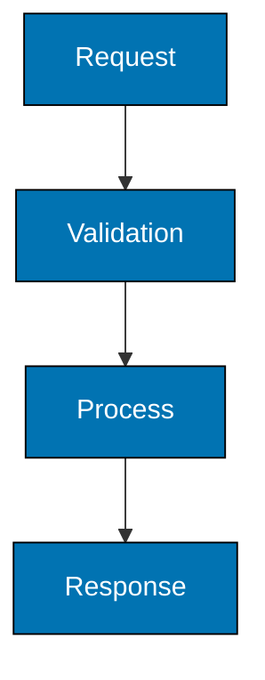
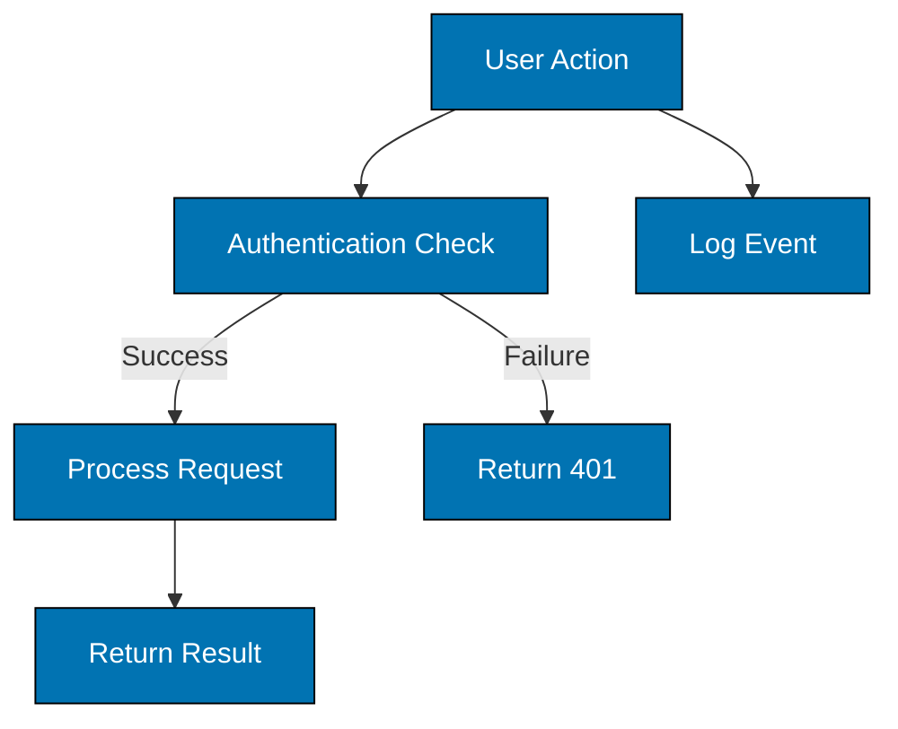
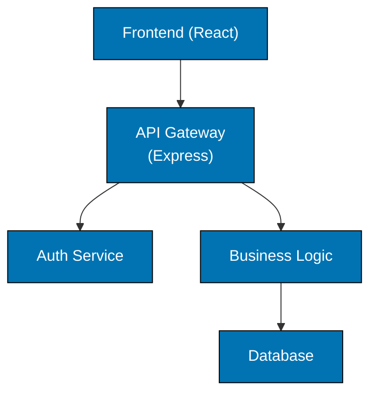

# ASCII Art Use Cases

## Directory Structure

Perfect for showing file and folder hierarchies:

```
open-sharia-enterprise/
 ├── .opencode/                   # Secondary coding-agent binding
 │   ├── agent/               # Specialized AI agents
 │   └── skill/               # Progressive knowledge packages
 ├── docs/                      # Documentation (Diátaxis framework)
│   ├── tutorials/            # Learning-oriented guides
│   ├── how-to/               # Problem-oriented guides
│   ├── reference/            # Technical reference
│   └── explanation/          # Conceptual documentation
├── src/                       # Source code
├── package.json              # Node.js manifest
└── README.md                 # Project README
```

## Simple Diagrams

Basic flowcharts and relationships:



## Process Flow

Sequential steps with connectors:



## Component Relationships

System architecture overview:



## Tables and Matrices

Structured data representation:

```
┌──────────────┬─────────────────────────┐
│   Category   │         Example         │
├──────────────┼─────────────────────────┤
│  Tutorials   │  docs/tutorials/start.md│
│  How-To      │  docs/how-to/api.md     │
│  Reference   │  docs/reference/spec.md │
│  Explanation │  docs/explanation/arch.md│
└──────────────┴─────────────────────────┘
```
