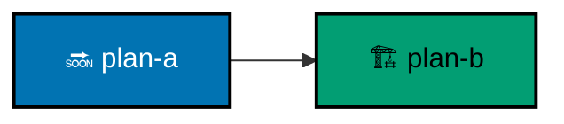

# Plan-Order Graph and Legend

A repository with more than one live plan carries a plan-order graph in `plans/README.md`: every plan in
`plans/backlog/` and `plans/in-progress/`, each dependency between them, and nothing else. A repository with one
live plan or none keeps the legend with an empty graph, so the convention stays visible where plans will appear.

## Always Updated

The graph is updated in the same change that moves, adds, or removes a plan: a promotion into `plans/in-progress/`,
an archival into `plans/done/`, a removal, or a new backlog plan. A plan move with no graph update in the same change
is a violation, and a graph naming a plan already under `plans/done/` is a violation. The graph and the latest
backlog-grooming order agree; a grooming pass that changes the order updates the graph in the same pass.

## Declarations

A plan declares its dependencies in its `README.md` as `Depends-on: [<plan-id>, ...]`, naming live plans only. A
dependency is satisfied only by its plan archived under `plans/done/`, or by it running earlier in the same scheduled
pass. Execution starts only once every declared dependency is satisfied; otherwise it stops and names the unmet one.
A missing declaration reads as no dependencies.

## Shared Legend

| Mark              | Means                                                                     |
| ----------------- | ------------------------------------------------------------------------- |
| blue `#0173B2` 🔜 | backlog: planned, not started                                             |
| teal `#029E73` 🏗️ | in progress: actively executed                                            |
| hexagon, `infra-` | steps only a credentialed machine performs; listed here as not applicable |
| solid arrow       | hard dependency: the predecessor is done first                            |
| dotted arrow      | soft order: the predecessor should land first, without blocking           |

Every graph carries an `accTitle` and `accDescr`, and its `classDef` lines carry the exact fills above. Plans with no
arrow between them may run in parallel.

## Decoupling With Feature Flags

A temporary production-disabled feature flag is a parallelism tool: behaviour incomplete for users lands as
complete-and-inert code, so producers and consumers proceed concurrently instead of serializing on the finished
surface. Both paths are tested, and rollout, rollback, and removal are recorded; the flag is removed once the
behaviour is complete. A flag never substitutes for a declared dependency between plans. A join plan declares several
dependencies and owns turning their flags off: flag removal is a delivery unit of the join plan, with its rollout
evidence, not scattered across the producers. Flags are essential because this is trunk-based development: the trunk
is the only persistent branch, so everything landing on it is deploy-ready, and flags keep parallel landings that way.
See [Preserve Trunk-Based Development](./prs-open-at-delivery-boundaries-natural-seams.md).
