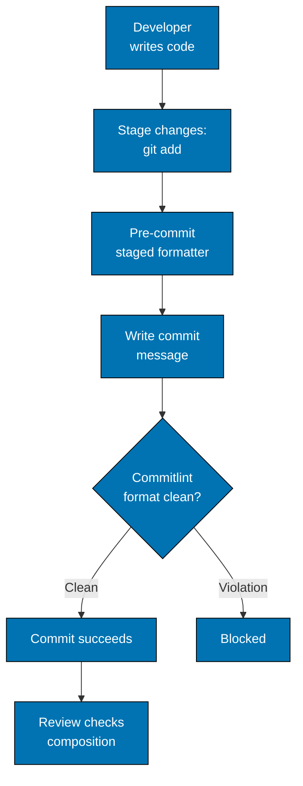

# How It's Checked

The commit-msg hook and the pull-request gate both run Commitlint against `commitlint.config.js`. A message that breaks
the Conventional Commits format stops the commit or fails the pull request. Review checks what Commitlint cannot: the
thematic boundary of each commit.

## What the Hooks Run

**Hook**: `.husky/commit-msg`, which runs `./rhino gate run --surface commit-msg --message-file "$1"` under the
`./hippo` guard.

**What it runs**: the only gate declared on the `commit-msg` surface, `commit-message`. It runs Commitlint with
`@commitlint/config-conventional` on the message, and checks type, scope, case, and description.

The `pull-request` surface lints each commit of the PR's base-to-head range on its own, through `commit-range-message`.
The `public-safety-commit-message` gate there screens each message for public-safety shapes, such as absolute home paths and private addresses, and the
`public-safety-range` gate at pre-push screens the pushed commits, messages included. List the live gate set with
`./rhino gate list` rather than trusting this page.

**Example block** (Commitlint names the rule that failed):

```text
⧗   input: bad message
✖   subject may not be empty [subject-empty]
✖   type may not be empty [type-empty]
✖   found 2 problems, 0 warnings
```

## Commitlint (On Demand)

**Tool**: [@commitlint/config-conventional](https://github.com/conventional-changelog/commitlint).
`@commitlint/cli` and `@commitlint/config-conventional` are pinned devDependencies in `package.json`.

**Configuration**: `commitlint.config.js`

```javascript
module.exports = {
  extends: ["@commitlint/config-conventional"],
};
```

**Note for Node.js 24+**: Node v24 introduced changes to module loading. Ensure:

- Project has `package.json` (this project uses npm workspaces )
- Or rename config to `commitlint.config.mjs` if using ES6 modules

**Run it yourself** against a message file; it exits 1 on a violation:

```bash
./hippo run --class ephemeral --resource-tier light --disk-path . -- \
  npm exec -- commitlint --edit <message-file>
```

**Validates:**

- Commit message format
- Valid types
- Description presence
- Character limits

**Example error:**

```bash
⧗   input: Added new feature
   subject may not be empty [subject-empty]
   type may not be empty [type-empty]

   found 2 problems, 0 warnings
ⓘ   Get help: https://github.com/conventional-changelog/commitlint/#what-is-commitlint
```

## Workflow



The pre-commit hook formats the staged files. The commit-msg hook runs Commitlint on the message, and the
pull-request gate lints each commit in the range. Review checks the thematic composition of the commits.
