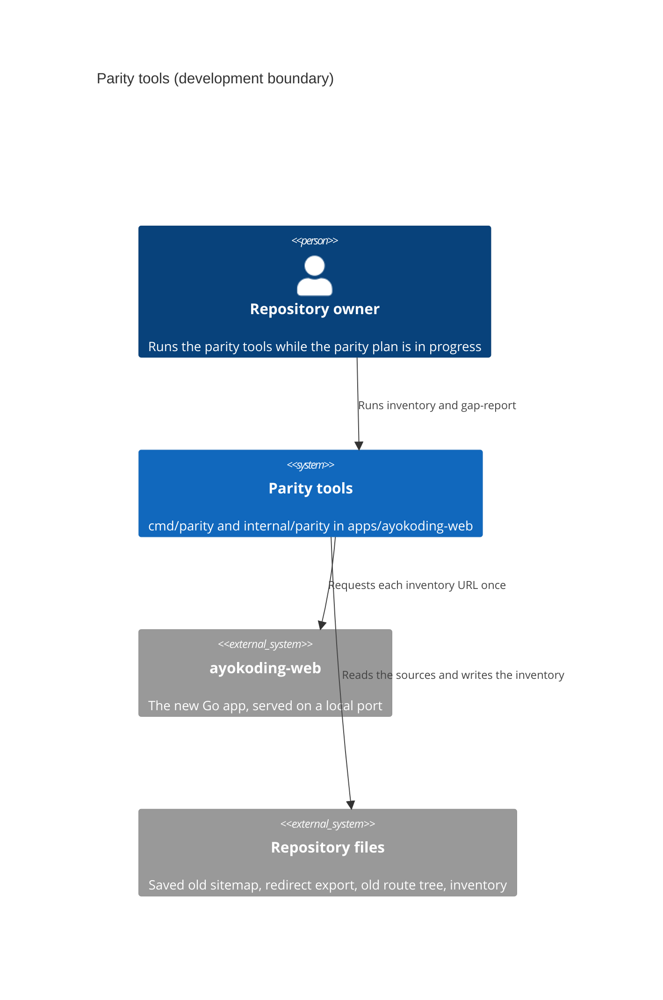

# AyoKoding Go Web — Architecture Status

> **Audience**: Engineers, Technical Product/Project Managers
>
> **Plain-language summary**: The Go rewrite is implemented. This document records the current
> implementation boundary so readers can distinguish accepted behavior from architecture that
> still needs implementation.

## Current implemented boundary

`apps/ayokoding-web` is a Go module serving the bilingual site with the standard library
(`net/http`, `html/template`) plus htmx fragment endpoints. Content renders through goldmark
with bluemonday sanitization, course paths resolve through manifest adapters, shared tool data
reads neutral JSON directly, and browser-only progress never leaves the browser.

The working educational site is still
[`apps/ayokoding-www`](../../../../apps/ayokoding-www/README.md), with its implemented
[architecture](../www/architecture.md) and [behavior corpus](../www/behaviours/README.md).
Its Markdown, manifests, and public assets remain in their current locations. The rewrite
reads those sources in place and does not claim ownership of them or stop existing content work.

### Parity tools

`cmd/parity` is the entry and `internal/parity` holds the logic, both in `apps/ayokoding-web`. They
build the inventory of old-site URLs from a saved sitemap, the committed redirect export, and the old
route tree, and they request each inventory URL from the new app once to report its gaps. Only the
owner's command line runs them; no other entry point calls them. Every file read, tree, write, and HTTP request goes through
`parity.Host`, and `OSHost` is the only operating-system wiring. Their behaviour is bound at Unit,
Integration, and E2E level by the [parity tools behaviours](./behaviours/parity-tools/README.md).

## Design location

The [rewrite plan](../../../../plans/in-progress/ayokoding-app-web/README.md) carries the
accepted Go components, interfaces, dependency choices, diagrams, local commands, and recovery
steps. The [behaviors](./behaviours/README.md) in this corpus are the accepted outcomes that
implementation proves through godog, Vitest, and Playwright adapters.

## Update obligation during implementation

In the same delivery unit that introduces a working component, replace the corresponding absence
statement with evidence from its actual source and configuration. Describe its system boundary,
runtime containers, and internal components with accessible C4 diagrams, which show a system
from its surrounding users down to its internal parts. Record actual module responsibilities,
shared-source paths, Go handler and browser-only state boundaries, test ownership, and local ports.

Keep future components in the plan until they exist. Do not describe deployment architecture in
this corpus while deployment remains outside the rewrite's scope.

## Related

- [Owner index](./README.md) — status, scope, and proof ownership.
- [Current site architecture](../www/architecture.md) — implemented reference system.
